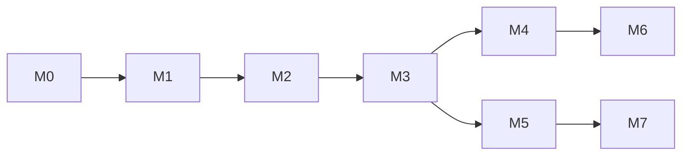

# ROADMAP

Документ фиксирует текущее состояние `bb-core` и план развития сервиса
автоматизированного бронирования. Источник истины по требованиям и схеме данных —
`docs/specification/`; roadmap не дублирует их, а показывает порядок работ.

Правила ведения:

- сроки не указываются: порядок важнее дат;
- статус задачи меняется в том же PR, что и код;
- веха считается закрытой, только когда выполнены все её пункты и критерии
  готовности из раздела 4.

## Легенда

| Статус | Значение |
| --- | --- |
| ✅ | реализовано и покрыто тестами |
| 🚧 | частично: есть схема, модель или заготовка, но сценарий не закончен |
| ⬜ | запланировано |
| ⏸ | отложено до внешнего решения |

| Приоритет | Значение |
| --- | --- |
| P0 | блокирует запуск или безопасную эксплуатацию |
| P1 | нужно для основного сценария бронирования |
| P2 | развитие, масштабирование, дополнительные каналы |

## 1. Текущее состояние

| Направление | Статус | Что уже есть |
| --- | --- | --- |
| Каркас приложения | ✅ | `cmd/api`, HTTP и gRPC, DI, `closer`, graceful shutdown |
| Конфигурация | ✅ | переменные окружения, `.env`, уровни и формат логов |
| База данных | ✅ | PostgreSQL (`pgx`) и SQLite (`modernc`), goose-миграции, диалект по `DSN` |
| Пользователи | ✅ | CRUD `user.v1`, роли `admin`/`operator`/`manager`/`client` |
| Аутентификация | ✅ | регистрация, вход, смена пароля, выход, JWT, отзыв сессий, Argon2id, `PASSWORD_TTL` |
| Bootstrap | ✅ | первый администратор через `cmd/bootstrap`, идемпотентно |
| Тенанты | 🚧 | схема, модель и репозиторий; `tenant.v1` сгенерирован, но сервис не зарегистрирован |
| Объекты аренды | 🚧 | таблицы `rental_objects`, `object_addons`, `photos`, расписание; Go-слоя и API нет |
| Бронирования | 🚧 | таблицы `bookings`, `booking_addons`, `bookings_journal`, ограничение пересечений; API нет |
| Платежи | 🚧 | таблица `payments`; универсального API и состояния `pending` нет; провайдеры — в других репозиториях |
| Уведомления | 🚧 | таблицы и пустые заготовки репозитория и сервиса; отправки нет |
| Мессенджеры | ⬜ | универсального интерфейса нет; модули Telegram, MAX, Discord, VK, Viber, WhatsApp, Facebook Messenger и Slack — в других репозиториях |
| Наблюдаемость | 🚧 | OTLP traces/logs/metrics, `trace_id` в логах, access-логи, метрики HTTP/gRPC/pgx |
| Кэш | 🚧 | интерфейс и DI; реализация — заглушка без Redis |
| API-контракты | 🚧 | gRPC + grpc-gateway + Swagger для `user.v1` и `auth.v1`; `tenant.v1` не подключён |
| Качество | ✅ | unit/smoke-тесты, порог покрытия 80 %, `golangci-lint`, `bearer`, `govulncheck`, CodeQL, Trivy |
| Доставка | 🚧 | `Makefile` и GitHub Actions; Dockerfile, compose, k8s и CD отсутствуют |

Схема БД опережает код: миграции `00005`–`00007` уже описывают объекты, брони,
платежи и уведомления, но соответствующих сервисов и ручек ещё нет.

## 2. Продуктовые вехи

### M0. Фундамент и аутентификация — ✅

Цель: приложение запускается, хранит пользователей и выдаёт проверяемые токены.

- [x] HTTP- и gRPC-серверы с общим набором операций.
- [x] Конфигурация из окружения, `.env` для разработки.
- [x] Подключение PostgreSQL и SQLite, автоматические миграции.
- [x] Регистрация, вход, смена пароля, выход и профиль действующего пользователя.
- [x] JWT HS256 и отзыв токенов через `user_tokens`.
- [x] Argon2id и прозрачный пересчёт старых хешей PBKDF2.
- [x] Срок жизни пароля `PASSWORD_TTL` и код `password_expired`.
- [x] Bootstrap первого администратора.
- [x] OTLP-экспорт трасс, метрик и логов, access-логи.
- [x] Smoke-тесты HTTP и gRPC, покрытие не ниже 80 %.

### M1. Мультитенантность — 🚧 (P0)

Цель: пользователь попадает в тенант по ссылке, публичный каталог доступен без
членства, а данные тенанта изолированы. Доступ проверяется по членству и роли;
исключение — публичная информация всех тенантов. Клиент видит публичную
информацию любого тенанта; admin/operator/manager видят клиента только в своём
тенанте и только если у клиента есть любая бронь в этом тенанте, включая
отменённые. PaaS и on-premise — модели поставки; глобального control plane нет,
но суперпользователь и назначенные им глобальные операторы управляют всеми
тенантами внутри установки.

#### M1a. Изоляция, вход по ссылке и сессии — P0

- [x] Таблицы `tenants`, `tenant_members`, справочник `roles`.
- [x] Роль — атрибут членства, а не профиля пользователя.
- [x] Сессия привязана к тенанту (`user_tokens.tenant_id`).
- [x] Модели `Tenant` и `TenantMember`, `TenantRepo`.
- [x] ADR `docs/adr/0001-multi-tenancy-and-tenant-switch.md`: ссылка на тенант,
  onboarding, switch, видимость и идемпотентность.
- [ ] Публичная страница тенанта `/t/{tenant_slug}` и публичные ручки каталога.
- [ ] Регистрация по ссылке создаёт клиентское членство в тенанте ссылки, а не
  личный тенант; политика для существующих личных тенантов.
- [ ] `GET /auth/tenants` и `POST /auth/tenant/switch`.
- [ ] `POST /auth/logout-all`; отзыв сессий при удалении членства, смене роли и
  приостановке тенанта.
- [ ] Bootstrap печатает `tenant_slug` и ссылку для входа.
- [ ] Добавить `tenant_id` в `rental_objects`, `bookings`, `payments`,
  `notifications`; backfill, `NOT NULL`, составные FK и tenant-scoped уникальные
  ключи.
- [ ] Индексы по `tenant_id` и ограничения, не допускающие связей между тенантами.
- [ ] Проверка принадлежности к тенанту в репозиториях и сервисах, а не только в
  транспорте; публичные методы — явно tenant-agnostic.
- [ ] Visibility matrix: `user.v1.List/Get` не отдаёт глобальный список; staff
  видит только клиентов с любой бронью в своём тенанте.
- [ ] Проверка статуса тенанта при аутентификации (`suspended`, `deleted`) и
  отзыв уже выданных сессий.
- [ ] Интеграционные тесты изоляции, ссылки, регистрации, switch и `logout-all`.

#### M1b. Управление тенантами и on-premise — P1

- [ ] Зарегистрировать `tenant.v1.TenantService` в HTTP gateway и gRPC.
- [ ] Сервисный слой тенантов: создание, чтение, список, мягкое удаление.
- [ ] API управления участниками: добавление, исключение, смена роли, передача
  владения; создание тенанта вместе с owner-членством в одной транзакции.
- [ ] Onboarding/offboarding, slug, retention и аудит действий.
- [ ] On-premise требования — в 3.7: Dockerfile, compose, Helm, миграции,
  backup/restore и runbooks.
- [x] Глобальные операторы: суперпользователь назначает пользователей, которые
  администрируют все тенанты (`is_superuser`, `is_global_operator`).
- [ ] Service accounts и квоты не вводим.

### M2. Каталог объектов аренды — ⬜ (P1)

Цель: оператор управляет объектами, клиент находит и просматривает их; публичный
каталог доступен по ссылке на тенант и без членства.

- [ ] Контракт `objects.v1`: CRUD, список, фильтры, услуги, фото, расписание.
- [ ] Публичная страница тенанта `/t/{tenant_slug}` и публичный каталог объектов;
  публичный каталог всех тенантов остаётся доступным.
- [ ] Публичные поля: карточка объекта, фото, цена, услуги, расписание и
  доступность; без PII, платежей и внутренних идентификаторов.
- [ ] Модели, репозитории и сервисы объектов, услуг и фото.
- [ ] Выдача справочников `type_objects`, `locations`, `statuses`.
- [ ] CRUD объектов для `admin`/`operator`, мягкое удаление через статус `deleted`.
- [ ] Список с фильтрами: тип, подтип, локация, цена, доступность, пагинация.
- [ ] Дополнительные услуги и их цены в минорных единицах.
- [ ] Фото: загрузка в S3/MinIO после реализации S3 (см. 3.3), до 10 на объект,
  JPEG/PNG, лимит 5 МБ.
- [ ] Правила расписания (`object_weekday_rules`) и исключения
  (`object_schedule_exceptions`).
- [ ] Кэширование каталога после реального Redis (см. 3.3); ключи включают
  `tenant_id`; инвалидация при изменении объекта.
- [ ] Публичные методы — явно tenant-agnostic, приватные — требуют tenant scope.
- [ ] Swagger, unit- и интеграционные тесты.

Открытый вопрос: типы аренды и тарифы (посуточная, поминутная, помесячная,
сеанс) есть в ТЗ, но пока не описаны в ERDB и миграциях. Их модель нужно
согласовать до реализации расчёта стоимости в M3.

### M3. Бронирования — ⬜ (P1)

Цель: клиент создаёт, меняет и отменяет бронь, система не допускает пересечений.
Бронь создаётся в тенанте из токена; объект должен принадлежать этому тенанту.

- [ ] Контракт `bookings.v1`: создание, список «мои», чтение, изменение, отмена.
- [ ] Проверка доступности: расписание, минимальная длительность, пересечения.
- [ ] Защита от гонок: в PostgreSQL — `EXCLUDE`, в SQLite — частичный уникальный
  индекс и проверка в транзакции; конфликт возвращается как `409`.
- [ ] Расчёт стоимости: тариф, длительность, дополнительные услуги, валюта.
- [ ] Статусы и допустимые переходы, запись снимка в `bookings_journal`.
- [ ] Идемпотентность создания по `Idempotency-Key`: `bookings.idempotency_key`,
  уникальность `(tenant_id, client_id, idempotency_key)`; повтор возвращает ту
  же бронь, другой payload — `409`.
- [ ] Типы бронирования: без ожидания, 1 минута, 30 минут, с подтверждением;
  схема хранения hold-политики в ERDB и миграциях.
- [ ] Фоновое истечение неподтверждённых броней.
- [ ] История бронирований пользователя.
- [ ] Экспорт события в Google Calendar — P2, после основного сценария.
- [ ] Тесты конкурентных запросов и e2e-сценарий «ссылка → регистрация → бронь».

### M4. Платежи — ⬜ (P2)

Цель: `bb-core` предоставляет универсальный интерфейс платежей, а конкретные
провайдеры оплаты живут в отдельных репозиториях и взаимодействуют с ним по
общему контракту. Платёж создаётся в тенанте из токена и привязывается к брони.

- [ ] Контракт `payments.v1`: инициализация платежа, получение статуса и приём
  события от сервиса-провайдера.
- [ ] Единая модель платежа: `pending`, `succeeded`, `failed`, `refunded`.
- [ ] `payments.idempotency_key` и `external_id`; уникальность
  `(tenant_id, idempotency_key)`; повтор возвращает тот же платёж, другой
  `booking_id` или сумма — `409`.
- [ ] Сумма берётся из брони; произвольный amount на первом этапе не принимается.
- [ ] Связь платежа с бронью и переходы статусов брони.
- [ ] Вебхук идемпотентен по `external_id`; повторное событие не меняет статус
  повторно и не создаёт дубль уведомления.
- [ ] Корреляция `booking_id` ↔ `payment_id` ↔ `external_id`.
- [ ] Аутентификация вызовов от сервисов-провайдеров (mTLS или подпись; общие
  service accounts не вводим).
- [ ] Возвраты и чеки: `bb-core` отражает статус, сформированный провайдером.
- [ ] Контрактные тесты и моки внешних сервисов; SDK провайдеров в этом
  репозитории не появляются.
- [ ] Документировать границы ответственности: `bb-core` хранит платёж и
  статус, а SDK провайдеров, их секреты и вебхуки остаются в других
  репозиториях.
- [ ] E2E: ссылка → регистрация → бронь → оплата → уведомление; повторная оплата
  с тем же `Idempotency-Key`.

### M5. Уведомления — ⬜ (P1)

Цель: пользователь получает уведомления о статусах брони и напоминания.

- [ ] Репозиторий: постановка в очередь, выборка due, claim/lease для нескольких
  воркеров, отметки sent/failed, retry с backoff и dedup.
- [ ] Сервис уведомлений и шаблоны сообщений.
- [ ] API подписок: подписаться, список, отписаться.
- [ ] Воркер отправки с graceful shutdown и ограничением параллелизма.
- [ ] Каналы: сначала email (SMTP/SendGrid) и push (FCM); мессенджеры — после
  контракта M7.
- [ ] Напоминания о событиях и смена статуса брони.
- [ ] Тесты retry, dedup, dead-letter и отсутствия секретов в payload и логах.

### M6. Аналитика и операторские функции — ⬜ (P2)

Цель: оператор видит метрики, брони и аудит, выгружает отчёты.

- [ ] API аналитики: брони, доход, загрузка, популярные объекты.
- [ ] Периоды day/week/month и фильтр по тенанту.
- [ ] Экспорт в Excel/PDF.
- [ ] Аудит действий операторов: кто, что и когда изменил.
- [ ] Права `operator`/`admin`, ограничение данными своего тенанта.
- [ ] Rate limiting и CORS для веб-панели (совместно с 3.4).

### M7. Универсальный интерфейс мессенджеров — ⬜ (P2)

Цель: `bb-core` предоставляет единый контракт для модулей мессенджеров, а
Telegram, MAX, Discord, VK, Viber, WhatsApp, Facebook Messenger и Slack
реализуются в отдельных репозиториях.

- [ ] Контракт `messaging.v1`: приём событий, отправка сообщений и привязка
  внешнего аккаунта.
- [ ] Единая модель канала: `channel`, `external_user_id`, `chat_id`,
  `message_id`, `payload`, `status`.
- [ ] Реестр каналов: `telegram`, `max`, `discord`, `vk`, `viber`, `whatsapp`,
  `facebook`, `slack`. Текущий `notification_channel` — ENUM
  `telegram/email/push`; расширение требует миграции или справочника каналов.
- [ ] Идемпотентность и дедупликация входящих событий.
- [ ] Универсальные действия: текст, медиа, кнопки и ответ на callback.
- [ ] Привязка мессенджер-аккаунта к `user_credentials`
  (`provider = <channel>`).
- [ ] Выдача уведомлений модулю канала через универсальный контракт.
- [ ] Аутентификация вызовов от модулей-мессенджеров (mTLS или подпись; общие
  service accounts не вводим).
- [ ] Контрактные тесты и моки; SDK, токены и вебхуки мессенджеров остаются в
  других репозиториях.
- [ ] Сценарии диалога (меню, карточки, календарь) реализуются в репозиториях
  модулей, а не в `bb-core`.

## 3. Инженерный backlog

### 3.1. Надёжность и health — P0

- [ ] `/health` проверяет БД (`SELECT 1` с таймаутом) и отвечает `503` при
  недоступности.
- [ ] Описать семантику `/health` или разделить liveness и readiness.
- [ ] gRPC health отражает готовность зависимостей, а не только запуск процесса.
- [ ] Таймауты и retry-политика для БД, HTTP и gRPC.
- [ ] Проверка миграций up/down для PostgreSQL и SQLite в CI.

### 3.2. Наблюдаемость — P1

- [x] OTLP-экспорт трасс, метрик и логов.
- [x] `trace_id` в логах, access-логи, нормализованные маршруты.
- [x] Трассы pgx через `otelpgx`.
- [ ] Экспорт метрик в Prometheus (сейчас только OTLP; отмечено в `programming.md`).
- [ ] Бизнес-метрики: созданные и отменённые брони, платежи, глубина очереди
  уведомлений.
- [ ] Исходящие спаны для Redis и S3; входящие события от сервисов-провайдеров
  оплаты и модулей-мессенджеров попадают в общую трассу запроса.
- [ ] Дашборды Grafana и алерты для критических ошибок.
- [ ] Политика сэмплирования и проверка, что PII и секреты не попадают в атрибуты.
- [ ] `tenant_id` в логах и спанах; в метках метрик — только с учётом
  кардинальности, без PII.

### 3.3. Данные и хранилища — P1

- [ ] Реальный Redis-клиент вместо заглушки, TTL и инвалидация; ключи включают
  `tenant_id`. Это prerequisite для кэша каталога в M2.
- [ ] S3/MinIO для фото, документов и чеков; ключи включают `tenant_id`. Это
  prerequisite для фото в M2.
- [ ] Резервное копирование `pg_dump` → S3 и проверка восстановления; для
  on-premise — обязательный production gate.
- [ ] Индексы и `EXPLAIN` для ключевых запросов при объёме до 1 млн строк.
- [ ] Стратегия seed и расширения справочников.
- [ ] Безопасные миграции без простоя (expand/contract) для будущих изменений.

### 3.4. Безопасность — P0/P1

- [ ] Rate limiting для `login`, `register`, `password`, `switch` и публичных
  ручек; ключи по IP, пользователю и тенанту.
- [ ] Защита от brute force: задержки, блокировки, метрики неудачных входов.
- [ ] Восстановление пароля по email (`POST /auth/reset-password` из `API.md`).
- [ ] Подтверждение email.
- [ ] Refresh-токены и ротация: сейчас access-токен живёт 30 дней.
- [ ] Двухфакторная аутентификация — опционально.
- [ ] CORS и TLS-терминация на API gateway.
- [ ] Проверка подлинности событий от сервисов-провайдеров оплаты и
  модулей-мессенджеров (mTLS или подпись; общие service accounts не вводим).
- [ ] Управление секретами: запрет пустого `JWT_SECRET` в production.
- [ ] Аудит административных действий и просмотров профилей клиентов staff.
- [ ] SBOM и подпись образов после появления Docker.

### 3.5. API и контракты — P0/P1

- [ ] Синхронизировать `API.md`, `README.md` и `HOWTO.md` с фактическими ручками;
  описать `/t/{tenant_slug}`, публичный каталог.
- [ ] Единый формат ошибок (`error`, `code`, `details`) и документированные коды.
- [ ] Единая пагинация `page_size`/`page_token` для всех списков.
- [ ] `Idempotency-Key` для create-операций брони и платежа; описать повтор и
  конфликт `409`.
- [ ] Проверка drift OpenAPI в CI: генерация не должна менять `pkg/api`.
- [ ] Политика версионирования `/v1` → `/v2`.
- [ ] Подключить `tenant.v1` (см. M1b).

### 3.6. Тестирование и качество — P0/P1

- [x] Unit- и smoke-тесты, покрытие не ниже 80 %.
- [x] `golangci-lint`, `bearer`, `govulncheck`, CodeQL и Trivy.
- [x] Интеграционные тесты PostgreSQL в CI: CI выставляет `PG`, тесты
  `Test*Postgres` и `TestMigratePostgres` используют его.
- [ ] E2E-сценарий: ссылка → публичный каталог → регистрация → бронь → оплата →
  уведомление.
- [ ] Тест конкурентных броней на ограничении БД.
- [ ] Тесты идемпотентности брони и платежа: повтор и конфликт `Idempotency-Key`.
- [ ] Контрактные тесты proto и OpenAPI.
- [ ] `go test -race` в CI.
- [ ] Нагрузочный тест: 100 rps и p95 не выше 300 мс.
- [ ] Fuzz-тесты санитайзера и парсеров — P2.

### 3.7. Доставка и инфраструктура — P1/P2

- [ ] On-premise gate: Dockerfile (multi-stage, non-root, минимальная база, без
  критичных CVE), compose, Helm, конфигурация и миграции.
- [ ] `docker-compose` для локального запуска: PostgreSQL, Redis, OTel Collector,
  Jaeger, MinIO.
- [ ] Kubernetes/Helm: Deployment, Service, probes, HPA, PDB, resources.
- [ ] CI: сборка образа, Trivy, подпись и публикация.
- [ ] CD: dev/staging/prod и отдельный job миграций.
- [ ] Backup/restore runbook и проверка восстановления (см. 3.3).
- [ ] Релизные теги и changelog.
- [ ] GitOps/ArgoCD, если выбран Kubernetes.

### 3.8. Документация — P1

- [ ] Обновлять `README.md` и `HOWTO.md` при каждой вехе.
- [ ] ADR для ключевых решений: Redis, S3, контракт платёжного интерфейса,
  контракт интерфейса мессенджеров; `docs/adr/0001-multi-tenancy-and-tenant-switch.md`
  уже описывает multi-tenancy и вход по ссылке.
- [ ] Runbooks: инциденты, восстановление БД, ротация секретов.
- [ ] Руководство пользователя и оператора (требование ТЗ).
- [ ] API guide с примерами `tenant_slug`, публичного каталога, брони и оплаты с
  `Idempotency-Key`.
- [ ] Docs-lint в CI: markdownlint, проверка ссылок и misspell для `docs/**`.

## 4. Критерии готовности фичи

Фича считается готовой, когда выполнены все пункты:

- Контракт: proto, валидация, HTTP и gRPC, Swagger; `tenant_slug` и
  `Idempotency-Key`, где применимо; обратная совместимость.
- Код: model → repository → service → transport, зависимости через DI.
- Ошибки оборачиваются через `%w`, наружу отдаются фиксированные тексты.
- Права проверяются в сервисе по роли и тенанту, а не только в транспорте;
  visibility matrix соблюдается.
- Миграции для PostgreSQL и SQLite, индексы и ограничения.
- Спан, метрики и логи с `trace_id`; пользовательские значения санитизированы,
  секретов нет.
- Unit- и интеграционные тесты; покрытие бизнес-логики не ниже 80 %.
- `make test`, `make coverage`, `make lint`, `make go-check`, `make build`
  проходят.
- Документация обновлена: `README.md`, `HOWTO.md`, при необходимости
  `API.md` и `ERDB.md`.
- Публичные ручки входят в явный allowlist и не отдают PII.
- Create-операции брони и платежа идемпотентны: повтор возвращает тот же
  результат, конфликт — `409`.

## 5. Порядок и приоритеты

- **P0 — до первого рабочего контура:** вход по ссылке и onboarding, `tenant_id`
  и изоляция, switch и `logout-all`, visibility matrix, проверка БД в `/health`,
  rate limiting аутентификации, синхронизация API-документации.
- **P1 — основной сценарий:** объекты → брони → уведомления, реальный Redis,
  Prometheus, Docker/compose, on-premise packaging, интеграционные и нагрузочные
  тесты.
- **P2 — развитие:** платежи, интеграции с мессенджерами, аналитика и экспорт,
  Kubernetes/CD, 2FA.

Рекомендуемая последовательность: **M1a → M1b → M2 → M3 → M5 → M4 → M6 / M7**.
Платежи (M4) можно начинать параллельно с уведомлениями (M5) после стабилизации
статусов брони в M3.

Гейты:

- M2 не начинать без реального Redis и S3 или без явного descope кэша и фото.
- Messenger-канал в M5 — после контракта M7; сначала email и push.
- M4 — после стабилизации статусов брони в M3.
- Backup/restore и on-premise packaging — production gate, а не «на потом».

## 6. Открытые вопросы и риски

| Вопрос | Почему важно | Когда решить |
| --- | --- | --- |
| Нет `tenant_id` в бизнес-таблицах | изоляция данных держится только на коде приложения | M1a |
| Пользователь не знает `tenant_slug`; личные тенанты legacy | без ссылки или приглашения вход невозможен | до M1a |
| Public-read allowlist не определён | риск утечки PII или нереализуемое требование | до M2 |
| Visibility matrix staff не закреплена в коде | staff может увидеть клиента без брони | до M1a |
| Нет модели тарифов и типов аренды | без неё нельзя корректно считать стоимость | до M3 |
| В `payments` нет `pending`, `idempotency_key` и `external_id` | нельзя отразить платёж до подтверждения и защититься от дублей | до M4 |
| `Idempot_id` не стандартизирован | разные имена в API и БД ломают контракт | до M3/M4 |
| Нет сценария первой брони для нового клиента | staff не видит клиента без брони | до M3 |
| Границы с репозиториями провайдеров не зафиксированы | неясно, кто инициирует платёж, присылает статус и хранит секреты | до M4 |
| Границы с репозиториями мессенджеров не зафиксированы | неясно, кто хранит токены, принимает вебхуки и владеет состоянием диалога | до M7 |
| Access-токен живёт 30 дней | долгий срок повышает цену компрометации; нужна ротация | до production |
| Реализация кэша — заглушка | каталог и сессии не кэшируются по-настоящему | перед M2 |
| Нет проверки восстановления бэкапов | бэкап без проверки не считается готовым | до production |
| On-premise packaging отсутствует | без Docker/compose/Helm сервис не поставить на стороне клиента | до production |
| `API.md` шире реализации | клиенты могут программировать несуществующие ручки | P0 |

## 7. Ссылки

- [adr/0001-multi-tenancy-and-tenant-switch.md](adr/0001-multi-tenancy-and-tenant-switch.md) —
  мультитенантность, вход по ссылке, switch и идемпотентность.
- [specification/TT.md](specification/TT.md) — исходное техническое задание.
- [specification/technical.md](specification/technical.md) — функциональные и
  нефункциональные требования.
- [specification/architecture.md](specification/architecture.md) — архитектура и
  интеграции.
- [specification/ERDB.md](specification/ERDB.md) — схема данных и связи.
- [specification/API.md](specification/API.md) — целевая спецификация API.
- [specification/programming.md](specification/programming.md) — правила кода,
  логирования, тестов и сборки.
- [specification/telegram-bot-api.md](specification/telegram-bot-api.md) — контракт
  Telegram Bot API.
- [specification/user_schema_mapping.md](specification/user_schema_mapping.md) —
  соответствие профиля пользователя Telegram API.
- [HOWTO.md](HOWTO.md) — практические инструкции по запуску и наблюдаемости.
- [../README.md](../README.md) — быстрый старт.

---

Roadmap пересматривается при закрытии каждой вехи: выполненные пункты
помечаются, новые задачи добавляются в соответствующий раздел, а не в конец
документа.
