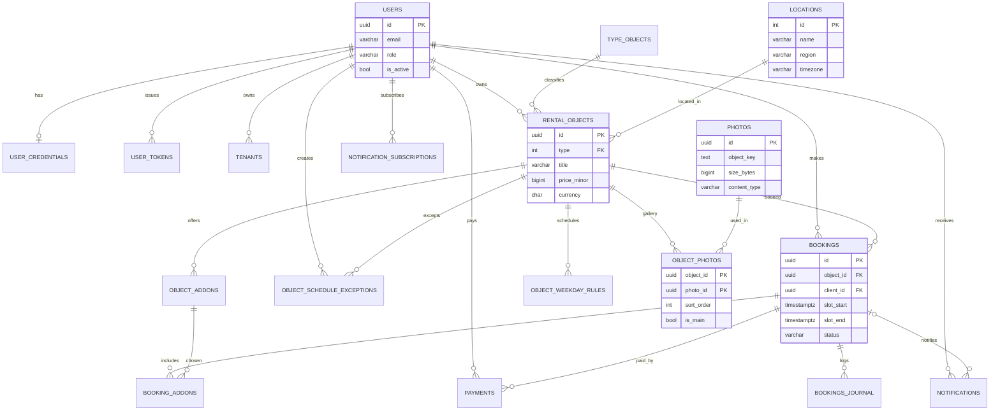

# ER‑диаграмма базы данных сервиса автоматизированного бронирования

Ниже представлена детальная схема сущностей, их атрибутов и взаимосвязей.
Имена сущностей доменные, поэтому рядом в скобках указано **физическое имя
таблицы** из миграций (`migrations/postgres/`, `migrations/sqlite/`) — так
документ сверяется с кодом. Визуализация дана в двух видах: **Mermaid**
(`erDiagram`, нотация «вороньи лапки») и текстовая схема в **нотации Питера
Чена** (раздел 5).

## 1. Соглашения о типах и именовании

| Тема | Решение |
| --- | --- |
| Первичный ключ | `UUID` (в SQLite — `TEXT`); значение генерирует приложение (`model.New*`, UUIDv4), `DEFAULT` нет. Исключение — справочники (`TypeObjects`, `Locations`): `INT`. |
| Внешний ключ | Тот же тип, что у PK цели; имя `<сущность>_id`. |
| Время | `TIMESTAMPTZ` в PostgreSQL, строка RFC3339 в SQLite; хранение и обмен — в UTC. |
| Деньги | `BIGINT` в минорных единицах (копейки) + `CHAR(3)` — код валюты ISO‑4217; `float` не используется. |
| Удаление | Мягкое: флаги `is_active` и `is_delete`; жёсткий `DELETE` — только для связок и каскадов. |
| Перечисления | Нативный `ENUM` в PostgreSQL, `TEXT` + `CHECK` в SQLite. |
| Миграции | `goose`, один файл = одна версия, секции `-- +goose Up/Down`, без `IF NOT EXISTS`. |

## 2. Список сущностей и их атрибуты

### 2.1. Tenant (tenants, арендатор)

Организация‑владелец; в коде описана контрактом `tenant.v1`.

- `id` (PK) — UUID NOT NULL;
- `name` — VARCHAR(100) NOT NULL;
- `slug` — VARCHAR(100) NOT NULL, UNIQUE;
- `status` — ENUM('active', 'suspended', 'deleted') NOT NULL DEFAULT 'active';
- `metadata` — JSONB (произвольные настройки);
- `user_id` — UUID (FK → `users.id`), владелец тенанта;
- `created_at` — TIMESTAMPTZ NOT NULL;
- `updated_at` — TIMESTAMPTZ NOT NULL.

### 2.2. User (users)

- `id` (PK) — UUID NOT NULL;
- `email` — VARCHAR(254) NOT NULL;
- `first_name` — VARCHAR(100) NOT NULL;
- `last_name` — VARCHAR(100) NOT NULL;
- `middle_name` — VARCHAR(100) NOT NULL DEFAULT '';
- `phone_number` — VARCHAR(20) NOT NULL DEFAULT '';
- `gender` — ENUM('unspecified', 'male', 'female') NOT NULL DEFAULT 'unspecified';
- `birth_date` — DATE NULL;
- `role` — ENUM('client', 'operator', 'admin') NOT NULL DEFAULT 'client';
- `created_at` — TIMESTAMPTZ NOT NULL;
- `updated_at` — TIMESTAMPTZ NOT NULL;
- `last_login_at` — TIMESTAMPTZ NULL;
- `is_active` — BOOLEAN NOT NULL DEFAULT true;
- `is_delete` — BOOLEAN NOT NULL DEFAULT false.

### 2.3. UserCredentials (user_credentials, служебная)

Хеш пароля вынесен из профиля: он нужен только при входе, тогда как профиль
читается почти каждым запросом.

- `user_id` (PK, FK) — UUID (FK → `users.id`, ON DELETE CASCADE);
- `password_hash` — VARCHAR(255) NOT NULL (bcrypt);
- `created_at` — TIMESTAMPTZ NOT NULL;
- `updated_at` — TIMESTAMPTZ NOT NULL.

### 2.4. UserTokens (user_tokens, служебная)

Список выданных JWT; позволяет отозвать токен до истечения срока.

- `id` (PK) — UUID NOT NULL (claim `jti`);
- `user_id` — UUID NOT NULL (FK → `users.id`, ON DELETE CASCADE);
- `role` — ENUM('client', 'operator', 'admin') NOT NULL (на момент выдачи);
- `issued_at` — TIMESTAMPTZ NOT NULL;
- `expires_at` — TIMESTAMPTZ NOT NULL;
- `revoked_at` — TIMESTAMPTZ NULL;
- `last_used_at` — TIMESTAMPTZ NULL.

### 2.5. TypeObjects (type_objects, справочник)

Единственная сущность с целочисленным PK: значения стабильны и меняются редко.

- `id` (PK) — INT, автоинкремент;
- `title` — VARCHAR(100) NOT NULL.

### 2.6. Locations (locations, справочник населённых пунктов)

Справочник городов и населённых пунктов (по аналогии с `TypeObjects` —
целочисленный PK). Часовой пояс хранится здесь: у населённого пункта он один,
поэтому объект получает его через связь `location_id`.

- `id` (PK) — INT, автоинкремент;
- `name` — VARCHAR(100) NOT NULL (например, «Екатеринбург»);
- `type` — VARCHAR(50) NOT NULL (город, посёлок, село, деревня, …);
- `region` — VARCHAR(100) NOT NULL (например, «Свердловская область»);
- `population` — INT NULL (численность населения);
- `lat` — DOUBLE PRECISION NULL (широта; в SQLite — REAL);
- `lon` — DOUBLE PRECISION NULL (долгота; в SQLite — REAL);
- `timezone` — VARCHAR(64) NOT NULL (IANA, например `Asia/Yekaterinburg`);
- `created_at` — TIMESTAMPTZ NOT NULL;
- `updated_at` — TIMESTAMPTZ NOT NULL.

### 2.7. Objects (rental_objects, объекты аренды)

- `id` (PK) — UUID NOT NULL;
- `type` — INT NOT NULL (FK → `type_objects.id`), тип объекта;
- `subtype` — VARCHAR(50);
- `title` — VARCHAR(100) NOT NULL;
- `description` — TEXT;
- `price_minor` — BIGINT NOT NULL (цена в минорных единицах);
- `currency` — CHAR(3) NOT NULL (ISO‑4217);
- `min_duration_minutes` — INT NOT NULL (минимальная длительность аренды);
- `location_id` — INT (FK → `locations.id`), населённый пункт;
- `address` — VARCHAR(255) (точный адрес, например «ул. Ленина, 1»);
- `status` — ENUM('active', 'under_repair', 'archived') NOT NULL DEFAULT 'active';
- `owner_id` — UUID (FK → `users.id`), владелец/оператор объекта;
- `created_at` — TIMESTAMPTZ NOT NULL;
- `updated_at` — TIMESTAMPTZ NOT NULL;
- `is_active` — BOOLEAN NOT NULL DEFAULT true;
- `is_delete` — BOOLEAN NOT NULL DEFAULT false.

### 2.8. ObjectAddons (object_addons, дополнительные услуги)

- `id` (PK) — UUID NOT NULL;
- `object_id` — UUID NOT NULL (FK → `rental_objects.id`, ON DELETE CASCADE);
- `name` — VARCHAR(100) NOT NULL;
- `price_minor` — BIGINT NOT NULL;
- `currency` — CHAR(3) NOT NULL;
- `duration_minutes` — INT NOT NULL DEFAULT 0;
- `created_at` — TIMESTAMPTZ NOT NULL.

### 2.9. Photos (photos, фотографии) — бизнес‑сущность

Фото — самостоятельный бизнес‑ресурс: файл лежит в S3‑совместимом хранилище
(MinIO/S3), а в БД хранятся ключ и метаданные. Один файл может использоваться
несколькими объектами аренды (связь «многие ко многим», раздел 3), поэтому
признак «главное фото» и порядок показа живут не здесь, а в связке
`object_photos`.

- `id` (PK) — UUID NOT NULL;
- `object_key` — TEXT NOT NULL (ключ объекта в S3; сам файл в БД не хранится);
- `content_type` — VARCHAR(255) NOT NULL DEFAULT 'application/octet-stream';
- `size_bytes` — BIGINT NOT NULL;
- `width` — INT NULL (ширина в пикселях);
- `height` — INT NULL (высота в пикселях);
- `created_at` — TIMESTAMPTZ NOT NULL;
- `is_active` — BOOLEAN NOT NULL DEFAULT true;
- `is_delete` — BOOLEAN NOT NULL DEFAULT false.

### 2.10. ObjectsPhotos (object_photos, связка M:N)

Ассоциативная сущность между `Objects` и `Photos`. Составной PK не даёт
привязать одно фото к объекту дважды, а атрибуты связи описывают роль фото
**для конкретного объекта**.

- `object_id` (PK, FK) — UUID (FK → `rental_objects.id`, ON DELETE CASCADE);
- `photo_id` (PK, FK) — UUID (FK → `photos.id`, ON DELETE CASCADE);
- `sort_order` — INT NOT NULL DEFAULT 0 (порядок в галерее);
- `is_main` — BOOLEAN NOT NULL DEFAULT false (обложка объекта);
- `created_at` — TIMESTAMPTZ NOT NULL.

### 2.11. ObjectWeekdayRules (object_weekday_rules, правила расписания)

Шаблон недели; слоты в БД не хранятся, а вычисляются из правил (см. `#201`).

- `id` (PK) — UUID NOT NULL;
- `object_id` — UUID NOT NULL (FK → `rental_objects.id`, ON DELETE CASCADE);
- `weekday` — SMALLINT NOT NULL (0 — понедельник … 6 — воскресенье);
- `opens_at` — TIME NOT NULL (в SQLite — TEXT 'HH:MM');
- `closes_at` — TIME NOT NULL;
- `slot_step_minutes` — INT NOT NULL (шаг сетки, 5..1440);
- `valid_from` — DATE NULL;
- `valid_to` — DATE NULL;
- `timezone` — VARCHAR(64) NOT NULL (IANA, например `Europe/Moscow`);
- `updated_at` — TIMESTAMPTZ NOT NULL.

### 2.12. ObjectScheduleExceptions (object_schedule_exceptions, исключения)

- `id` (PK) — UUID NOT NULL;
- `object_id` — UUID NOT NULL (FK → `rental_objects.id`, ON DELETE CASCADE);
- `period_start` — TIMESTAMPTZ NOT NULL;
- `period_end` — TIMESTAMPTZ NOT NULL;
- `reason` — VARCHAR(255);
- `created_by` — UUID (FK → `users.id`), кто создал;
- `created_at` — TIMESTAMPTZ NOT NULL.

### 2.13. Bookings (bookings, бронирования)

- `id` (PK) — UUID NOT NULL;
- `object_id` — UUID NOT NULL (FK → `rental_objects.id`);
- `client_id` — UUID NOT NULL (FK → `users.id`), кто бронирует;
- `slot_start` — TIMESTAMPTZ NOT NULL;
- `slot_end` — TIMESTAMPTZ NOT NULL;
- `status` — ENUM('pending', 'confirmed', 'paid', 'cancelled', 'completed') NOT NULL DEFAULT 'pending';
- `total_price_minor` — BIGINT NOT NULL DEFAULT 0;
- `currency` — CHAR(3) NOT NULL;
- `idempotency_key` — VARCHAR(64) NULL;
- `cancel_reason` — VARCHAR(255) NULL;
- `cancelled_at` — TIMESTAMPTZ NULL;
- `created_at` — TIMESTAMPTZ NOT NULL;
- `updated_at` — TIMESTAMPTZ NOT NULL.

### 2.14. BookingAddons (booking_addons, услуги в брони)

Снимок выбранных услуг: `unit_price_minor` фиксирует цену на момент брони,
поэтому изменение прайса не переписывает историю.

- `booking_id` (PK, FK) — UUID (FK → `bookings.id`, ON DELETE CASCADE);
- `addon_id` (PK, FK) — UUID (FK → `object_addons.id`);
- `quantity` — INT NOT NULL DEFAULT 1;
- `unit_price_minor` — BIGINT NOT NULL.

### 2.15. BookingsJournal (bookings_journal, журнал бронирований)

Аудит: неизменяемый снимок состояния брони на момент изменения (намеренная
денормализация ради истории и разбора инцидентов).

- `id` (PK) — UUID NOT NULL;
- `booking_id` — UUID NOT NULL (FK → `bookings.id`);
- `user_id` — UUID (FK → `users.id`), автор изменения;
- `object_id` — UUID (FK → `rental_objects.id`);
- `slot_start` — TIMESTAMPTZ NOT NULL;
- `slot_end` — TIMESTAMPTZ NOT NULL;
- `status` — ENUM('pending', 'confirmed', 'paid', 'cancelled', 'completed') NOT NULL;
- `total_price_minor` — BIGINT NOT NULL;
- `currency` — CHAR(3) NOT NULL;
- `created_at` — TIMESTAMPTZ NOT NULL (момент записи в журнал).

### 2.16. Payments (payments, платежи)

- `id` (PK) — UUID NOT NULL;
- `booking_id` — UUID NOT NULL (FK → `bookings.id`);
- `user_id` — UUID NOT NULL (FK → `users.id`), плательщик;
- `amount_minor` — BIGINT NOT NULL;
- `currency` — CHAR(3) NOT NULL;
- `payment_method` — ENUM('card', 'sbp', 'wallet') NOT NULL;
- `status` — ENUM('succeeded', 'failed', 'refunded') NOT NULL;
- `paid_at` — TIMESTAMPTZ NULL;
- `created_at` — TIMESTAMPTZ NOT NULL.

### 2.17. Notifications (notifications, уведомления)

Схема описана в `#402`; `payload` — JSONB (в SQLite `TEXT`), секреты не хранятся.

- `id` (PK) — UUID NOT NULL;
- `user_id` — UUID NOT NULL (FK → `users.id`, ON DELETE CASCADE);
- `booking_id` — UUID NULL (FK → `bookings.id`);
- `channel` — ENUM('telegram', 'email', 'push') NOT NULL;
- `template_code` — VARCHAR(64) NOT NULL;
- `payload` — JSONB (в SQLite — TEXT);
- `status` — ENUM('pending', 'processing', 'sent', 'failed') NOT NULL DEFAULT 'pending';
- `attempts` — SMALLINT NOT NULL DEFAULT 0;
- `next_attempt_at` — TIMESTAMPTZ NULL;
- `sent_at` — TIMESTAMPTZ NULL;
- `last_error` — TEXT NULL;
- `dedup_key` — VARCHAR(128) NOT NULL;
- `created_at` — TIMESTAMPTZ NOT NULL.

### 2.18. NotificationSubscriptions (notification_subscriptions)

- `user_id` (PK, FK) — UUID (FK → `users.id`, ON DELETE CASCADE);
- `channel` (PK) — ENUM('telegram', 'email', 'push');
- `endpoint` (PK) — VARCHAR(255) (chat_id, e‑mail или device token);
- `is_active` — BOOLEAN NOT NULL DEFAULT true.

## 3. Связи между сущностями (Relationships)

### 3.1. Обзор связей

| Связь | Кардинальность | Внешний ключ | ON DELETE | Смысл |
| --- | --- | --- | --- | --- |
| User → Tenant | 1:N | `tenants.user_id → users.id` | RESTRICT | владелец тенанта |
| User → UserCredentials | 1:1 | `user_credentials.user_id → users.id` | CASCADE | пароль пользователя |
| User → UserTokens | 1:N | `user_tokens.user_id → users.id` | CASCADE | выданные сессии |
| User → Objects | 1:N | `rental_objects.owner_id → users.id` | RESTRICT | владелец объекта |
| TypeObjects → Objects | 1:N | `rental_objects.type → type_objects.id` | RESTRICT | тип объекта |
| Locations → Objects | 1:N | `rental_objects.location_id → locations.id` | RESTRICT | населённый пункт объекта |
| Objects → ObjectAddons | 1:N | `object_addons.object_id → rental_objects.id` | CASCADE | услуги объекта |
| Objects ↔ Photos | **M:N** | `object_photos` | CASCADE | галерея объекта |
| Objects → ObjectWeekdayRules | 1:N | `object_weekday_rules.object_id → rental_objects.id` | CASCADE | правила расписания |
| Objects → ObjectScheduleExceptions | 1:N | `object_schedule_exceptions.object_id → rental_objects.id` | CASCADE | исключения расписания |
| User → ObjectScheduleExceptions | 1:N | `object_schedule_exceptions.created_by → users.id` | SET NULL | автор исключения |
| User → Bookings | 1:N | `bookings.client_id → users.id` | RESTRICT | брони клиента |
| Objects → Bookings | 1:N | `bookings.object_id → rental_objects.id` | RESTRICT | брони объекта |
| Bookings → BookingAddons | 1:N | `booking_addons.booking_id → bookings.id` | CASCADE | услуги в брони |
| ObjectAddons → BookingAddons | 1:N | `booking_addons.addon_id → object_addons.id` | RESTRICT | выбранная услуга |
| Bookings → Payments | 1:N | `payments.booking_id → bookings.id` | CASCADE | платежи по брони |
| User → Payments | 1:N | `payments.user_id → users.id` | RESTRICT | плательщик |
| Bookings → BookingsJournal | 1:N | `bookings_journal.booking_id → bookings.id` | CASCADE | история изменений |
| User → Notifications | 1:N | `notifications.user_id → users.id` | CASCADE | уведомления адресату |
| Bookings → Notifications | 1:N | `notifications.booking_id → bookings.id` | SET NULL | уведомление по брони |
| User → NotificationSubscriptions | 1:N | `notification_subscriptions.user_id → users.id` | CASCADE | подписки пользователя |

Итог: одна связь **M:N** (`Objects ↔ Photos`), одна **1:1**
(`User ↔ UserCredentials`), остальные — **1:N**.

### 3.2. Objects ↔ Photos (многие‑ко‑многим)

Связь реализована ассоциативной сущностью `ObjectsPhotos` (`object_photos`):

- `Objects` (1) —— (N) `ObjectsPhotos` (N) —— (1) `Photos`;
- составной PK `(object_id, photo_id)` запрещает дубли связи;
- `is_main` и `sort_order` — атрибуты связи, а не фото: одно и то же фото может
  быть обложкой для одного объекта и обычным снимком для другого;
- правило «не более 10 фото на объект» (см. `TT.md`, `architecture.md`)
  проверяется на уровне приложения: декларативного лимита по числу дочерних
  строк в SQL нет;
- «ровно одно главное фото на объект» обеспечивает частичный уникальный индекс
  `object_photos_main_idx` (см. раздел 4).

### 3.3. Каскады удаления

- `CASCADE` — где дочерняя запись без родителя бессмысленна (пароль и токены
  пользователя, услуги и расписание объекта, услуги брони, платежи, журнал,
  связка фото, подписки).
- `RESTRICT` — где удаление родителя разрушило бы историю или чужие данные
  (владелец объекта, тип, клиент/объект в брони, плательщик, добавка в снимке
  брони).
- `SET NULL` — для необязательных ссылок (автор исключения, бронь в
  уведомлении): запись остаётся, ссылка обнуляется.
- Мягкое удаление: для сущностей с `is_active`/`is_delete` жёсткого `DELETE`
  нет — записи скрываются флагами.

## 4. Ограничения и индексы

Имена индексов фиксированы явно (как `users_email_idx`), чтобы они совпадали в
PostgreSQL и SQLite и были предсказуемы в планах запросов.

### 4.1. tenants

- PK: `tenants_pkey (id)`;
- UNIQUE: `tenants_slug_idx (slug)`;
- CHECK: `status IN ('active', 'suspended', 'deleted')`;
- FK: `user_id → users(id)`;
- Index: `tenants_user_id_idx (user_id)`.

### 4.2. users

- PK: `users_pkey (id)`;
- UNIQUE (частичный): `users_email_idx (email) WHERE is_active = true` — один
  активный адрес; удалённые не мешают повторной регистрации;
- UNIQUE (частичный): `users_phone_number_idx (phone_number) WHERE phone_number <> ''`;
- CHECK: `role IN ('client', 'operator', 'admin')`;
- Index: `users_role_idx (role)`.

### 4.3. user_credentials

- PK: `user_credentials_pkey (user_id)`;
- FK: `user_id → users(id) ON DELETE CASCADE`.

### 4.4. user_tokens

- PK: `user_tokens_pkey (id)`;
- FK: `user_id → users(id) ON DELETE CASCADE`;
- CHECK: `role IN ('client', 'operator', 'admin')`, `expires_at > issued_at`;
- Index: `user_tokens_user_id_idx (user_id)`,
  `user_tokens_expires_at_idx (expires_at)`.

### 4.5. type_objects

- PK: `type_objects_pkey (id)`;
- UNIQUE: `type_objects_title_idx (title)`.

### 4.6. locations

- PK: `locations_pkey (id)`;
- UNIQUE: `locations_name_region_idx (name, region)` — нет дублей населённого
  пункта в одном регионе;
- CHECK: `population IS NULL OR population >= 0`,
  `lat IS NULL OR lat BETWEEN -90 AND 90`,
  `lon IS NULL OR lon BETWEEN -180 AND 180`;
- Index: `locations_region_idx (region)`.

### 4.7. rental_objects

- PK: `rental_objects_pkey (id)`;
- FK: `type → type_objects(id)`, `location_id → locations(id)`,
  `owner_id → users(id)`;
- CHECK: `price_minor >= 0`, `min_duration_minutes > 0`,
  `status IN ('active', 'under_repair', 'archived')`,
  `char_length(currency) = 3`;
- Index: `rental_objects_type_subtype_status_idx (type, subtype, status)`;
- Index: `rental_objects_location_idx (location_id)`;
- Index (частичный): `rental_objects_owner_active_idx (owner_id) WHERE is_active = true`.

### 4.8. object_addons

- PK: `object_addons_pkey (id)`;
- FK: `object_id → rental_objects(id) ON DELETE CASCADE`;
- CHECK: `price_minor >= 0`, `duration_minutes >= 0`;
- Index: `object_addons_object_id_idx (object_id)`.

### 4.9. photos

- PK: `photos_pkey (id)`;
- UNIQUE: `photos_object_key_idx (object_key)` — один ключ в S3 = одна запись;
- CHECK: `size_bytes >= 0`, `width IS NULL OR width > 0`,
  `height IS NULL OR height > 0`.

### 4.10. object_photos

- PK: `object_photos_pkey (object_id, photo_id)`;
- FK: `object_id → rental_objects(id) ON DELETE CASCADE`,
  `photo_id → photos(id) ON DELETE CASCADE`;
- UNIQUE (частичный): `object_photos_main_idx (object_id) WHERE is_main = true` —
  не более одной обложки на объект;
- Index: `object_photos_photo_id_idx (photo_id)` — обратный поиск «где
  используется фото».

### 4.11. object_weekday_rules

- PK: `object_weekday_rules_pkey (id)`;
- FK: `object_id → rental_objects(id) ON DELETE CASCADE`;
- CHECK: `weekday BETWEEN 0 AND 6`, `slot_step_minutes BETWEEN 5 AND 1440`,
  `opens_at < closes_at`;
- Index: `object_weekday_rules_object_id_idx (object_id)`.

### 4.12. object_schedule_exceptions

- PK: `object_schedule_exceptions_pkey (id)`;
- FK: `object_id → rental_objects(id) ON DELETE CASCADE`,
  `created_by → users(id) ON DELETE SET NULL`;
- CHECK: `period_end > period_start`;
- Index: `object_schedule_exceptions_object_period_idx (object_id, period_start, period_end)`.

### 4.13. bookings

- PK: `bookings_pkey (id)`;
- FK: `object_id → rental_objects(id)`, `client_id → users(id)`;
- CHECK: `slot_end > slot_start`, `total_price_minor >= 0`,
  `status IN ('pending', 'confirmed', 'paid', 'cancelled', 'completed')`;
- UNIQUE: `bookings_idempotency_idx (client_id, idempotency_key)`;
- Анти‑оверлап (PostgreSQL, расширение `btree_gist`):
  `bookings_no_overlap EXCLUDE USING gist (object_id WITH =,`
  `tstzrange(slot_start, slot_end, '[)') WITH &&)`
  `WHERE (status IN ('pending', 'confirmed', 'paid'))`;
- Анти‑оверлап (SQLite, fallback) — частичный уникальный индекс:
  `bookings_object_slot_idx (object_id, slot_start)`
  `WHERE status IN ('pending', 'confirmed', 'paid')`;
- Index: `bookings_client_slot_idx (client_id, slot_start DESC)`;
- Index: `bookings_object_start_idx (object_id, slot_start)`.

### 4.14. booking_addons

- PK: `booking_addons_pkey (booking_id, addon_id)`;
- FK: `booking_id → bookings(id) ON DELETE CASCADE`,
  `addon_id → object_addons(id)`;
- CHECK: `quantity > 0`, `unit_price_minor >= 0`.

### 4.15. bookings_journal

- PK: `bookings_journal_pkey (id)`;
- FK: `booking_id → bookings(id) ON DELETE CASCADE`, `user_id → users(id)`,
  `object_id → rental_objects(id)`;
- Index: `bookings_journal_booking_idx (booking_id, created_at DESC)`.

### 4.16. payments

- PK: `payments_pkey (id)`;
- FK: `booking_id → bookings(id) ON DELETE CASCADE`, `user_id → users(id)`;
- CHECK: `amount_minor >= 0`, `payment_method IN ('card', 'sbp', 'wallet')`,
  `status IN ('succeeded', 'failed', 'refunded')`;
- Index: `payments_booking_idx (booking_id)`, `payments_status_idx (status)`.

### 4.17. notifications

- PK: `notifications_pkey (id)`;
- FK: `user_id → users(id) ON DELETE CASCADE`,
  `booking_id → bookings(id) ON DELETE SET NULL`;
- UNIQUE: `notifications_dedup_key_idx (dedup_key)`;
- CHECK: `channel IN ('telegram', 'email', 'push')`,
  `status IN ('pending', 'processing', 'sent', 'failed')`, `attempts >= 0`;
- Index (частичный): `notifications_due_idx (next_attempt_at) WHERE status = 'pending'`
  — выборка для `ClaimDue`;
- Index: `notifications_user_created_idx (user_id, created_at DESC)`.

### 4.18. notification_subscriptions

- PK: `notification_subscriptions_pkey (user_id, channel, endpoint)`;
- FK: `user_id → users(id) ON DELETE CASCADE`;
- CHECK: `channel IN ('telegram', 'email', 'push')`.

## 5. Визуализация связей

### 5.1. Mermaid (нотация «вороньи лапки»)

Ассоциативная сущность `OBJECT_PHOTOS` показана отдельной таблицей — так видны
атрибуты связи; логически это связь «многие ко многим» между `RENTAL_OBJECTS` и
`PHOTOS`.



### 5.2. Нотация Питера Чена (текстовая)

```text
Users 1 ──< N Objects                     (owner_id)
Users 1 ──< N Bookings                    (client_id)
Users 1 ──< N Payments                    (user_id)
Users 1 ──< N Notifications               (user_id)
Users 1 ──< N UserTokens                  (user_id)
Users 1 ──  1 UserCredentials             (user_id)
Users 1 ──< N Tenants                     (user_id)
Users 1 ──< N NotificationSubscriptions   (user_id)
Users 1 ──< N ObjectScheduleExceptions    (created_by)

TypeObjects 1 ──< N Objects               (type)
Locations 1 ──< N Objects                 (location_id)

Objects 1 ──< N ObjectAddons
Objects 1 ──< N ObjectWeekdayRules
Objects 1 ──< N ObjectScheduleExceptions
Objects 1 ──< N Bookings                  (object_id)
Objects M ──< N Photos                    (через object_photos)

Bookings 1 ──< N BookingAddons
Bookings 1 ──< N Payments
Bookings 1 ──< N BookingsJournal
Bookings 1 ──< N Notifications            (booking_id, nullable)

ObjectAddons 1 ──< N BookingAddons        (addon_id)
```

## 6. Примечания

1. **Нормализация.** Схема приведена к 3NF. Осознанные исключения:
   `BookingsJournal` хранит снимок брони (денормализация ради истории и
   аудита), а признаки `is_active`/`is_delete` — это мягкое удаление вместо
   физического.
2. **Идентификаторы.** PK бизнес‑сущностей — `UUID` (генерирует приложение,
   UUIDv4): значения не конфликтуют при слиянии данных и известны до записи в
   БД. Справочники (`TypeObjects`, `Locations`) используют `INT` — значения стабильны и
   меняются редко.
3. **Деньги.** Хранятся как `BIGINT` в минорных единицах (копейки) вместе с
   `CHAR(3)` — кодом валюты ISO‑4217. `float`/`DECIMAL` не используются:
   дробные округления недопустимы в расчётах броней.
4. **Масштабируемость.** При росте нагрузки — горизонтальный шардинг по
   `owner_id` (объекты) и `client_id` (брони); «горячие» выборки (доступность
   объекта, активные брони, очередь уведомлений) закрыты составными и
   частичными индексами.
5. **Целостность броней.** Защита от двойной брони заложена на уровне БД:
   `EXCLUDE`‑ограничение в PostgreSQL (расширение `btree_gist`) и частичный
   уникальный индекс плюс проверка в транзакции в SQLite (см. 4.13).
6. **Безопасность.** Пароли хранятся только как хеши **bcrypt**
   (`user_credentials.password_hash`); в логах и трейсах нет PII (почта,
   телефон, payload уведомлений). Соединение — TLS.
7. **Диалекты.** Поддерживаются PostgreSQL 14+ (`ENUM`, `JSONB`, `btree_gist`)
   и SQLite (`TEXT` + `CHECK`, `PRAGMA foreign_keys = ON`, один писатель).
   Время в SQLite — строки RFC3339, значения — в UTC.
8. **Мягкое удаление.** Сущности с `is_active`/`is_delete` физически не
   удаляются; уникальность «живых» записей обеспечивают частичные уникальные
   индексы (`WHERE is_active`).
9. **Файлы.** Фото хранятся в S3‑совместимом хранилище (MinIO/S3), в БД —
   только ключ `object_key` и метаданные. Ограничения: не более 10 фото на
   объект, не более 5 МБ, форматы JPEG/PNG (см. `TT.md`, `architecture.md`).
10. **Миграции.** Изменения схемы — только goose‑миграциями
    (`migrations/postgres/`, `migrations/sqlite/`), один файл = одна версия,
    секции `-- +goose Up/Down`, без `IF NOT EXISTS`.
11. **Локализация.** Текстовые поля — UTF‑8; интерфейс — на русском языке.
12. **Синхронизация документации.** Схема в этом документе — источник истины:
    `API.md`, `architecture.md`, `technical.md` и `user_schema_mapping.md`
    приведены к ней (UUID вместо INT-PK, деньги — `BIGINT` в минорных единицах
    плюс `currency`, успех — `200 OK`, местоположение — `location_id` +
    `address`). Реализацию контрактов ведут задачи `#101`–`#503`; при
    расхождении сначала правьте `ERDB.md`, затем остальные спецификации.
