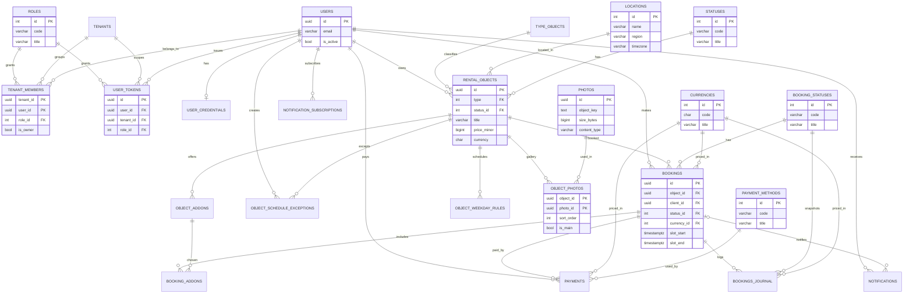

# ER‑диаграмма базы данных сервиса автоматизированного бронирования

Ниже представлена детальная схема сущностей, их атрибутов и взаимосвязей.
Имена сущностей доменные, поэтому рядом в скобках указано **физическое имя
таблицы** из миграций (`migrations/postgres/`, `migrations/sqlite/`) - так
документ сверяется с кодом. Визуализация дана в двух видах: **Mermaid**
(`erDiagram`, нотация «вороньи лапки») и текстовая схема в **нотации Питера
Чена** (раздел 5).

## 1. Соглашения о типах и именовании

| Тема | Решение |
| --- | --- |
| Первичный ключ | `UUID` (в SQLite - `TEXT`); значение генерирует приложение (`model.New*`, UUIDv4), `DEFAULT` нет. Исключение - справочники (`Roles`, `TypeObjects`, `Locations`, `Statuses`, `BookingStatuses`, `Currencies`, `PaymentMethods`): целочисленный `SMALLINT` (`INT` в SQLite) со значениями, назначенными миграцией. |
| Внешний ключ | Тот же тип, что у PK цели; имя `<сущность>_id`. |
| Справочники в API | На границе API значения справочников передаются строковым кодом (`code`: `RUB`, `pending`, `card`), а в БД хранится целочисленный внешний ключ (`<сущность>_id`). Соответствие «код <-> id» описано здесь и в `API.md`. |
| Время | `TIMESTAMPTZ` в PostgreSQL, строка RFC3339 в SQLite; хранение и обмен - в UTC. |
| Деньги | `BIGINT` в минорных единицах (копейки) + код валюты ISO‑4217. В бронях и платежах код заменён ссылкой на справочник `currencies` (`currency_id`), в `rental_objects`/`object_addons` пока хранится `CHAR(3)` (`currency`); `float` не используется. |
| Удаление | Мягкое: флаги `is_active`/`is_delete` (пользователи, фото), флаг `is_active` у справочников либо статус `deleted` в справочнике `statuses` (объекты аренды); жёсткий `DELETE` - только для связок и каскадов. |
| Перечисления | Нативный `ENUM` в PostgreSQL, `TEXT` + `CHECK` в SQLite. Справочниками вынесены роли (`roles`), статусы объектов (`statuses`), статусы броней (`booking_statuses`), валюты (`currencies`), способы оплаты (`payment_methods`): набор значений хранится в одном месте и проверяется ссылкой по целочисленному PK, а не дублирующимися ограничениями. |
| Роли | Роль - атрибут членства в тенанте (`tenant_members.role_id`, FK -> `roles.id`), а не профиля: в разных тенантах у одного пользователя могут быть разные роли. Сессия действует в рамках одного тенанта (`user_tokens.tenant_id`), а её роль - снимок роли членства на момент выдачи. |
| Миграции | `goose`, один файл = одна версия, секции `-- +goose Up/Down`, без `IF NOT EXISTS`. |

## 2. Список сущностей и их атрибуты

### 2.1. Tenant (tenants, арендатор)

Организация‑владелец; в коде описана контрактом `tenant.v1`. Тенант объединяет
группу пользователей (состав - в `tenant_members`, см. 2.2), поэтому отдельного
поля «владелец» у него нет: владелец - участник с `is_owner = true`, а один
пользователь может состоять в нескольких тенантах. Роль пользователя задаётся
его участием в тенанте (`tenant_members.role_id`, см. 2.2 и 2.6), поэтому в
разных тенантах одна и та же учётная запись может иметь разные роли.

- `id`         - (PK) UUID NOT NULL;
- `name`       - VARCHAR(255) NOT NULL;
- `slug`       - VARCHAR(255) NOT NULL, UNIQUE;
- `status`     - ENUM('active', 'suspended', 'deleted') NOT NULL DEFAULT 'active';
- `metadata`   - JSONB (произвольные настройки);
- `created_at` - TIMESTAMPTZ NOT NULL;
- `updated_at` - TIMESTAMPTZ NOT NULL.

### 2.2. TenantMembers (tenant_members, связка M:N)

Ассоциативная сущность между `Tenants` и `Users`: тенант объединяет группу
пользователей, а один пользователь может состоять в разных тенантах. Составной
PK не даёт добавить пользователя в тенант дважды.
!Внимание: Роль по умолчанию `32767` (client)

- `tenant_id` - (PK, FK) UUID (FK -> `tenants.id`, ON DELETE CASCADE);
- `user_id`   - (PK, FK) UUID (FK -> `users.id`, ON DELETE CASCADE);
- `role_id`   - SMALLINT NOT NULL DEFAULT 32767 (FK -> `roles.id`), роль пользователя **в этом тенанте** (см. 2.6);
- `is_owner`  - BOOLEAN NOT NULL DEFAULT false (владелец организации);
- `joined_at` - TIMESTAMPTZ NOT NULL.

`role_id` - атрибут членства, а не профиля: на пару «тенант + пользователь»
приходится ровно одна роль, а в разных тенантах у одного пользователя роли
независимы (например, `admin` в своём тенанте и `client` в чужом). Поэтому у
`users` нет колонки `role_id`, а значение claim `role` в JWT - снимок этой роли
на момент выдачи токена (см. 2.5).

Владелец тенанта - это его участник с `is_owner = true`; «ровно один владелец»
держит частичный уникальный индекс `tenant_members_owner_idx` (см. раздел 4).

### 2.3. User (users) профиль

- `id`           - (PK) UUID NOT NULL;
- `first_name`   - VARCHAR(100) NOT NULL DEFAULT ''; (не обязательное)
- `last_name`    - VARCHAR(100) NOT NULL DEFAULT '';
- `middle_name`  - VARCHAR(100) NOT NULL DEFAULT '';
- `phone_number` - VARCHAR(20) NOT NULL DEFAULT '';
- `gender`       - ENUM('unspecified', 'male', 'female') NOT NULL DEFAULT 'unspecified';
- `birth_date`   - DATE NULL;
- `created_at`   - TIMESTAMPTZ NOT NULL;
- `updated_at`   - TIMESTAMPTZ NOT NULL.

Роли у профиля нет: пользователь может состоять в нескольких тенантах и в
каждом иметь свою роль, поэтому роль хранится в членстве
(`tenant_members.role_id`, см. 2.2 и 2.6), а не в `users`.

### 2.4. UserCredentials (user_credentials, служебная)

Хеш пароля вынесен из профиля: он нужен только при входе.
Связь один `users.id` ко многим `user_credentials.user_id`.
Если не указан `provider`, авторизация по `'email'` (локально по HTTP/gRPC).

- `id`            - (PK) UUID NOT NULL;
- `user_id`       - (FK) UUID (FK -> `users.id`, ON DELETE CASCADE); (связь с профилем)
- `provider`      - VARCHAR(20) NOT NULL; (Тип провайдера: 'email', 'telegram', 'google', 'apple' и т.д.);
- `provider_key`  - VARCHAR(254) NOT NULL; (email, phone_number, уникальный ID внутри этого провайдера. для Telegram это числовой ID)
- `password_hash` - VARCHAR(254) NOT NULL; (Argon2id hash);
- `provider_meta` - JSONB; (Дополнительные метаданные провайдера. например, username для Telegram)
- `created_at`    - TIMESTAMPTZ NOT NULL;
- `last_login_at` - TIMESTAMPTZ NULL;
- `expires_at`    - TIMESTAMPTZ NOT NULL;
- `revoked_at`    - TIMESTAMPTZ NULL;
- `is_active`     - BOOLEAN NOT NULL DEFAULT true;
- `is_delete`     - BOOLEAN NOT NULL DEFAULT false.

Индекс для быстрого поиска пользователя при логине
CREATE INDEX idx_credentials_lookup ON user_credentials (provider, provider_key);

### 2.5. UserTokens (user_tokens, служебная)

Список выданных JWT; позволяет отозвать токен до истечения срока. Сессия
действует в рамках одного тенанта: роль пользователя зависит от тенанта,
поэтому в записи хранятся и `tenant_id`, и `role_id` - роль в этом тенанте на
момент выдачи (для аудита). Действующая роль берётся из `tenant_members` для
активного тенанта; ссылка идёт на тот же справочник `roles`, что и у членства.

- `id`           - (PK) UUID NOT NULL (claim `jti`);
- `user_id`      - UUID NOT NULL (FK -> `users.id`, ON DELETE CASCADE);
- `tenant_id`    - UUID NOT NULL (FK -> `tenants.id`, ON DELETE CASCADE), тенант сессии (claim `tenant`);
- `role_id`      - INT NOT NULL (FK -> `roles.id`), роль в тенанте на момент выдачи (см. 2.6);
- `issued_at`    - TIMESTAMPTZ NOT NULL;
- `expires_at`   - TIMESTAMPTZ NOT NULL;
- `revoked_at`   - TIMESTAMPTZ NULL;
- `last_used_at` - TIMESTAMPTZ NULL.

### 2.6. Roles (roles, справочник)

Справочник ролей участия в тенанте и выданных токенов. Введён вместо нативного
`ENUM`/`CHECK` в двух местах (`tenant_members`, `user_tokens`): набор значений
хранится в одном месте и проверяется ссылкой, а не дублирующимися
ограничениями. Роль - атрибут членства (`tenant_members.role_id`), а
`user_tokens.role_id` хранит её снимок на момент выдачи; обе ссылки смотрят на
один и тот же список.

- `id`        - (PK) SMALLINT; значения фиксированы и назначаются миграцией:
                `1` - `admin`, `2` - `operator`, `3` - `manager`, `32767` - `client` (поле можно обновлять или добавлять, удалять нельзя!);
- `code`      - VARCHAR(32) NOT NULL, UNIQUE; (Совпадает с `model.Role` и значением claim `role`);
- `title`     - VARCHAR(100) NOT NULL (человекочитаемое название);
- `is_active` - BOOLEAN NOT NULL DEFAULT true (если false - нельзя назначать).

INSERT INTO roles (id, code, title) VALUES
    (1, 'admin', 'Администратор'),
    (2, 'operator', 'Оператор'),
    (3, 'manager', 'Менеджер'),
    (32767, 'client', 'Пользователь');
Идентификаторы заданы явно (как у `statuses`): на значение `client`
(`id = 32767`) ссылается `DEFAULT` у `tenant_members.role_id`, поэтому
соответствие «число -> роль» должно быть стабильным и одинаковым для обоих
диалектов. Новые роли добавляются миграцией.

### 2.7. TypeObjects (type_objects, справочник)

Справочник с целочисленным PK (как `Roles`, `Locations` и `Statuses`): значения
стабильны и меняются редко.

- `id`    - (PK) SMALLINT, автоинкремент;
- `title` - VARCHAR(100) NOT NULL.

### 2.8. Locations (locations, справочник населённых пунктов)

Справочник городов и населённых пунктов (по аналогии с `TypeObjects` -
целочисленный PK). Часовой пояс хранится здесь: у населённого пункта он один,
поэтому объект получает его через связь `location_id`.

- `id`         - (PK) INT, автоинкремент;
- `name`       - VARCHAR(100) NOT NULL (например, «Екатеринбург»);
- `type`       - VARCHAR(50) NOT NULL (город, посёлок, село, деревня, …);
- `region`     - VARCHAR(100) NOT NULL (например, «Свердловская область»);
- `population` - INT NULL (численность населения);
- `lat`        - DOUBLE PRECISION NULL (широта; в SQLite - REAL);
- `lon`        - DOUBLE PRECISION NULL (долгота; в SQLite - REAL);
- `timezone`   - VARCHAR(64) NOT NULL (IANA, например `Asia/Yekaterinburg`);
- `created_at` - TIMESTAMPTZ NOT NULL;
- `updated_at` - TIMESTAMPTZ NOT NULL.

### 2.9. Statuses (statuses, справочник статусов)

Справочник статусов объектов аренды. Введён вместо нативного `ENUM`: набор
значений одинаков в PostgreSQL и SQLite, а ссылка по целочисленному PK
(`status_id`) убирает дублирование состояния. Раньше `status` сосуществовал с
флагами `is_active`/`is_delete`, поэтому одно и то же состояние («объект
активен», «объект удалён») можно было выразить двумя противоречащими способами.

- `id`    - (PK) SMALLINT; значения фиксированы и назначаются миграцией:
          `1` - `active`, `2` - `under_repair`, `3` - `archived`, `4` - `deleted`;
- `code`  - VARCHAR(20) NOT NULL, UNIQUE - машинное имя (совпадает со значениями `ObjectStatus` контракта);
- `title` - VARCHAR(100) NOT NULL (человекочитаемое название).

Идентификаторы заданы явно (не автоинкремент): на значение `active` ссылается
`DEFAULT` у `rental_objects.status_id`, поэтому соответствие «число -> статус»
должно быть стабильным и одинаковым для обоих диалектов. Новые статусы
добавляются миграцией - так же, как раньше добавлялись значения `ENUM`.

### 2.10. Objects (rental_objects, объекты аренды)

- `id`                   - (PK) UUID NOT NULL;
- `type`                 - INT NOT NULL (FK -> `type_objects.id`), тип объекта;
- `subtype`              - VARCHAR(50);
- `title`                - VARCHAR(100) NOT NULL;
- `description`          - TEXT;
- `price_minor`          - BIGINT NOT NULL (цена в минорных единицах);
- `currency`             - CHAR(3) NOT NULL (ISO‑4217);
- `min_duration_minutes` - INT NOT NULL (минимальная длительность аренды);
- `location_id`          - INT (FK -> `locations.id`), населённый пункт;
- `address`              - VARCHAR(254) (точный адрес, например «ул. Ленина, 1»);
- `status_id`            - INT NOT NULL DEFAULT 1 (FK -> `statuses.id`), статус объекта;
                           значение `1` - `active`, а «мягкое удаление» - это `status_id` = `4` (`deleted`), а не отдельный флаг `is_delete`;
- `owner_id`             - UUID (FK -> `users.id`), владелец/оператор объекта;
- `created_at`           - TIMESTAMPTZ NOT NULL;
- `updated_at`           - TIMESTAMPTZ NOT NULL.

### 2.11. ObjectAddons (object_addons, дополнительные услуги)

- `id`               - (PK) UUID NOT NULL;
- `object_id`        - UUID NOT NULL (FK -> `rental_objects.id`, ON DELETE CASCADE);
- `name`             - VARCHAR(100) NOT NULL;
- `price_minor`      - BIGINT NOT NULL;
- `currency`         - CHAR(3) NOT NULL;
- `duration_minutes` - INT NOT NULL DEFAULT 0;
- `created_at`       - TIMESTAMPTZ NOT NULL.

### 2.12. Photos (photos, фотографии) - бизнес‑сущность

Фото - самостоятельный бизнес‑ресурс: файл лежит в S3‑совместимом хранилище
(MinIO/S3), а в БД хранятся ключ и метаданные. Один файл может использоваться
несколькими объектами аренды (связь «многие ко многим», раздел 3), поэтому
признак «главное фото» и порядок показа живут не здесь, а в связке
`object_photos`.

- `id`           - (PK) UUID NOT NULL;
- `object_key`   - TEXT NOT NULL (ключ объекта в S3; сам файл в БД не хранится);
- `content_type` - VARCHAR(255) NOT NULL DEFAULT 'application/octet-stream';
- `size_bytes`   - BIGINT NOT NULL;
- `width`        - INT NULL (ширина в пикселях);
- `height`       - INT NULL (высота в пикселях);
- `created_at`   - TIMESTAMPTZ NOT NULL;
- `is_active`    - BOOLEAN NOT NULL DEFAULT true;
- `is_delete`    - BOOLEAN NOT NULL DEFAULT false.

### 2.13. ObjectsPhotos (object_photos, связка M:N)

Ассоциативная сущность между `Objects` и `Photos`. Составной PK не даёт
привязать одно фото к объекту дважды, а атрибуты связи описывают роль фото
**для конкретного объекта**.

- `object_id`  - (PK, FK) UUID (FK -> `rental_objects.id`, ON DELETE CASCADE);
- `photo_id`   - (PK, FK) UUID (FK -> `photos.id`, ON DELETE CASCADE);
- `sort_order` - INT NOT NULL DEFAULT 0 (порядок в галерее);
- `is_main`    - BOOLEAN NOT NULL DEFAULT false (обложка объекта);
- `created_at` - TIMESTAMPTZ NOT NULL.

### 2.14. ObjectWeekdayRules (object_weekday_rules, правила расписания)

Шаблон недели; слоты в БД не хранятся, а вычисляются из правил (см. `#201`).

- `id`                - (PK) UUID NOT NULL;
- `object_id`         - UUID NOT NULL (FK -> `rental_objects.id`, ON DELETE CASCADE);
- `weekday`           - SMALLINT NOT NULL (0 - понедельник … 6 - воскресенье);
- `opens_at`          - TIME NOT NULL (в SQLite - TEXT 'HH:MM');
- `closes_at`         - TIME NOT NULL;
- `slot_step_minutes` - INT NOT NULL (шаг сетки, 5..1440);
- `valid_from`        - DATE NOT NULL DEFAULT 0;
- `valid_to`          - DATE  NOT NULL DEFAULT 0;
- `timezone`          - VARCHAR(64) NOT NULL (IANA, например `Europe/Moscow`);
- `updated_at`        - TIMESTAMPTZ NOT NULL.

### 2.15. ObjectScheduleExceptions (object_schedule_exceptions, исключения)

- `id`           - (PK) UUID NOT NULL;
- `object_id`    - UUID NOT NULL (FK -> `rental_objects.id`, ON DELETE CASCADE);
- `period_start` - TIMESTAMPTZ NOT NULL;
- `period_end`   - TIMESTAMPTZ NOT NULL;
- `reason`       - VARCHAR(255);
- `created_by`   - UUID (FK -> `users.id`), кто создал;
- `created_at`   - TIMESTAMPTZ NOT NULL.

### 2.16. Bookings (bookings, бронирования)

- `id`                - (PK) UUID NOT NULL;
- `object_id`         - UUID NOT NULL (FK -> `rental_objects.id`);
- `client_id`         - UUID NOT NULL (FK -> `users.id`), кто бронирует;
- `slot_start`        - TIMESTAMPTZ NOT NULL;
- `slot_end`          - TIMESTAMPTZ NOT NULL;
- `status_id`         - SMALLINT NOT NULL DEFAULT 1 (FK -> `booking_statuses.id`), текущий статус брони; строковый код статуса - в справочнике (см. 2.22);
- `total_price_minor` - BIGINT NOT NULL DEFAULT 0;
- `currency_id`       - SMALLINT NOT NULL DEFAULT 1 (FK -> `currencies.id`), валюта суммы (см. 2.23);
- `idempotency_key`   - VARCHAR(64) NOT NULL DEFAULT '';
- `cancel_reason`     - VARCHAR(255) NOT NULL DEFAULT '';
- `cancelled_at`      - TIMESTAMPTZ NOT NULL DEFAULT 0;
- `created_at`        - TIMESTAMPTZ NOT NULL;
- `updated_at`        - TIMESTAMPTZ NOT NULL.

### 2.17. BookingAddons (booking_addons, услуги в брони)

Снимок выбранных услуг: `unit_price_minor` фиксирует цену на момент брони,
поэтому изменение прайса не переписывает историю.

- `booking_id`       - (PK, FK) UUID (FK -> `bookings.id`, ON DELETE CASCADE);
- `addon_id`         - (PK, FK) UUID (FK -> `object_addons.id`);
- `quantity`         - INT NOT NULL DEFAULT 1;
- `unit_price_minor` - BIGINT NOT NULL.

### 2.18. BookingsJournal (bookings_journal, журнал бронирований)

Аудит: неизменяемый снимок состояния брони на момент изменения (намеренная
денормализация ради истории и разбора инцидентов).

- `id`                - (PK) UUID NOT NULL;
- `booking_id`        - UUID NOT NULL (FK -> `bookings.id`);
- `user_id`           - UUID (FK -> `users.id`), автор изменения;
- `object_id`         - UUID (FK -> `rental_objects.id`);
- `slot_start`        - TIMESTAMPTZ NOT NULL;
- `slot_end`          - TIMESTAMPTZ NOT NULL;
- `status_id`         - SMALLINT NOT NULL (FK -> `booking_statuses.id`), снимок статуса брони (см. 2.22);
- `total_price_minor` - BIGINT NOT NULL;
- `currency_id`       - SMALLINT NOT NULL (FK -> `currencies.id`), валюта суммы (см. 2.23);
- `created_at`        - TIMESTAMPTZ NOT NULL (момент записи в журнал).

### 2.19. Payments (payments, платежи)

- `id`                - (PK) UUID NOT NULL;
- `booking_id`        - UUID NOT NULL (FK -> `bookings.id`);
- `user_id`           - UUID NOT NULL (FK -> `users.id`), плательщик;
- `amount_minor`      - BIGINT NOT NULL;
- `currency_id`       - SMALLINT NOT NULL (FK -> `currencies.id`), валюта суммы (см. 2.23);
- `payment_method_id` - SMALLINT NOT NULL (FK -> `payment_methods.id`), способ оплаты (см. 2.24);
- `status`            - ENUM('succeeded', 'failed', 'refunded') NOT NULL;
- `paid_at`           - TIMESTAMPTZ NOT NULL DEFAULT 0;
- `created_at`        - TIMESTAMPTZ NOT NULL.

### 2.20. Notifications (notifications, уведомления)

Схема описана в `#402`; `payload` - JSONB (в SQLite `TEXT`), секреты не хранятся.

- `id`              - (PK) UUID NOT NULL;
- `user_id`         - UUID NOT NULL (FK -> `users.id`, ON DELETE CASCADE);
- `booking_id`      - UUID NULL (FK -> `bookings.id`);
- `channel`         - ENUM('telegram', 'email', 'push') NOT NULL;
- `template_code`   - VARCHAR(64) NOT NULL;
- `payload`         - JSONB (в SQLite - TEXT);
- `status`          - ENUM('pending', 'processing', 'sent', 'failed') NOT NULL DEFAULT 'pending';
- `attempts`        - SMALLINT NOT NULL DEFAULT 0;
- `next_attempt_at` - TIMESTAMPTZ NOT NULL DEFAULT 0;
- `sent_at`         - TIMESTAMPTZ NOT NULL DEFAULT 0;
- `last_error`      - TEXT NOT NULL DEFAULT '';
- `dedup_key`       - VARCHAR(128) NOT NULL;
- `created_at`      - TIMESTAMPTZ NOT NULL.

### 2.21. NotificationSubscriptions (notification_subscriptions)

Подписка на уведомления: один `user_id` может подписаться на все доступные каналы

- `id`        - (PK) INT NOT NULL;
- `user_id`   - (FK) UUID (FK -> `users.id`, ON DELETE CASCADE);
- `channel`   - (PK) ENUM('telegram', 'email', 'push');
- `endpoint`  - (PK) VARCHAR(255) (chat_id, e‑mail или device token);
- `is_active` - BOOLEAN NOT NULL DEFAULT true.

### 2.22. BookingStatuses (booking_statuses, справочник статусов брони)

Справочник статусов брони, введён вместо нативного `ENUM` у `bookings.status` и
`bookings_journal.status`: набор значений хранится в одном месте, а ссылка по
целочисленному PK (`status_id`) позволяет гибко настраивать бизнес-процесс
(добавлять и переименовывать статусы миграцией, не меняя ограничения в двух
таблицах). `bookings.status_id` смотрит на текущее состояние, а
`bookings_journal.status_id` - на его снимок в аудите.

- `id`        - (PK) SMALLINT; значения фиксированы и назначаются миграцией:
                `1` - `pending`, `2` - `confirmed`, `3` - `paid`, `4` - `cancelled`, `5` - `completed`;
- `code`      - VARCHAR(20) NOT NULL, UNIQUE (машинное имя, совпадает со значениями `BookingStatus` контракта);
- `title`     - VARCHAR(100) NOT NULL (человекочитаемое название);
- `is_active` - BOOLEAN NOT NULL DEFAULT true (если false - статус нельзя назначать).

Идентификаторы заданы явно (не автоинкремент): на значение `pending` (`id = 1`)
ссылается `DEFAULT` у `bookings.status_id`, поэтому соответствие
«число -> статус» должно быть стабильным и одинаковым для обоих диалектов. Новые
статусы добавляются миграцией - так же, как раньше добавлялись значения `ENUM`.

### 2.23. Currencies (currencies, справочник валют)

Справочник валют (ISO‑4217). Введён вместо хранения кода `CHAR(3)` прямо в
таблицах броней и платежей: ссылка по целочисленному PK (`currency_id`) убирает
дублирование кода и в одной строке хранит его символ и число минорных единиц.
Используется в `bookings.currency_id`, `bookings_journal.currency_id` и
`payments.currency_id`. В `rental_objects.currency` и `object_addons.currency`
пока хранится код `CHAR(3)`: их перевод на справочник - отдельная задача.

- `id`          - (PK) SMALLINT; значения фиксированы и назначаются миграцией:
                  `1` - `RUB`, `2` - `USD`, `3` - `EUR`;
- `code`        - CHAR(3) NOT NULL, UNIQUE (код ISO‑4217 в верхнем регистре);
- `title`       - VARCHAR(100) NOT NULL (человекочитаемое название);
- `symbol`      - VARCHAR(8) NOT NULL DEFAULT '' (символ валюты, например `₽`);
- `minor_units` - SMALLINT NOT NULL DEFAULT 2 (число знаков после запятой);
- `is_active`   - BOOLEAN NOT NULL DEFAULT true (если false - валюту нельзя назначать).

Идентификаторы заданы явно: на значение `RUB` (`id = 1`) ссылается `DEFAULT` у
`bookings.currency_id`, поэтому соответствие «число -> валюта» должно быть
стабильным и одинаковым для обоих диалектов. Новые валюты добавляются миграцией.

### 2.24. PaymentMethods (payment_methods, справочник способов оплаты)

Справочник способов оплаты. Введён вместо нативного `ENUM` у
`payments.payment_method`: способ задаётся ссылкой по целочисленному PK
(`payment_method_id`), а список способов расширяется миграцией без изменения
ограничений таблицы `payments`.

- `id`        - (PK) SMALLINT; значения фиксированы и назначаются миграцией:
                `1` - `card`, `2` - `sbp`, `3` - `wallet`;
- `code`      - VARCHAR(20) NOT NULL, UNIQUE (машинное имя, совпадает со значениями `payment_method` контракта);
- `title`     - VARCHAR(100) NOT NULL (человекочитаемое название);
- `is_active` - BOOLEAN NOT NULL DEFAULT true (если false - способ нельзя выбирать).

Идентификаторы заданы явно; `payments.payment_method_id` ссылается на этот
справочник. Новые способы оплаты добавляются миграцией.

## 3. Связи между сущностями (Relationships)

### 3.1. Обзор связей

| Связь | Кардинальность | Внешний ключ | ON DELETE | Смысл |
| --- | --- | --- | --- | --- |
| Tenant ↔ User | **M:N** | `tenant_members` (tenant_id, user_id) | CASCADE | состав тенанта; пользователь может быть в разных тенантах |
| TenantMembers -> Roles | N:1 | `tenant_members.role_id -> roles.id` | RESTRICT | роль пользователя в тенанте |
| User -> UserCredentials | 1:1 | `user_credentials.user_id -> users.id` | CASCADE | пароль пользователя |
| User -> UserTokens | 1:N | `user_tokens.user_id -> users.id` | CASCADE | выданные сессии |
| Tenant -> UserTokens | 1:N | `user_tokens.tenant_id -> tenants.id` | CASCADE | сессии в рамках тенанта |
| UserTokens -> Roles | N:1 | `user_tokens.role_id -> roles.id` | RESTRICT | роль на момент выдачи |
| User -> Objects | 1:N | `rental_objects.owner_id -> users.id` | RESTRICT | владелец объекта |
| TypeObjects -> Objects | 1:N | `rental_objects.type -> type_objects.id` | RESTRICT | тип объекта |
| Locations -> Objects | 1:N | `rental_objects.location_id -> locations.id` | RESTRICT | населённый пункт объекта |
| Statuses -> Objects | 1:N | `rental_objects.status_id -> statuses.id` | RESTRICT | статус объекта |
| Objects -> ObjectAddons | 1:N | `object_addons.object_id -> rental_objects.id` | CASCADE | услуги объекта |
| Objects ↔ Photos | **M:N** | `object_photos` | CASCADE | галерея объекта |
| Objects -> ObjectWeekdayRules | 1:N | `object_weekday_rules.object_id -> rental_objects.id` | CASCADE | правила расписания |
| Objects -> ObjectScheduleExceptions | 1:N | `object_schedule_exceptions.object_id -> rental_objects.id` | CASCADE | исключения расписания |
| User -> ObjectScheduleExceptions | 1:N | `object_schedule_exceptions.created_by -> users.id` | SET NULL | автор исключения |
| User -> Bookings | 1:N | `bookings.client_id -> users.id` | RESTRICT | брони клиента |
| Objects -> Bookings | 1:N | `bookings.object_id -> rental_objects.id` | RESTRICT | брони объекта |
| Bookings -> BookingAddons | 1:N | `booking_addons.booking_id -> bookings.id` | CASCADE | услуги в брони |
| ObjectAddons -> BookingAddons | 1:N | `booking_addons.addon_id -> object_addons.id` | RESTRICT | выбранная услуга |
| Bookings -> Payments | 1:N | `payments.booking_id -> bookings.id` | CASCADE | платежи по брони |
| User -> Payments | 1:N | `payments.user_id -> users.id` | RESTRICT | плательщик |
| Bookings -> BookingsJournal | 1:N | `bookings_journal.booking_id -> bookings.id` | CASCADE | история изменений |
| BookingStatuses -> Bookings | N:1 | `bookings.status_id -> booking_statuses.id` | RESTRICT | текущий статус брони |
| BookingStatuses -> BookingsJournal | N:1 | `bookings_journal.status_id -> booking_statuses.id` | RESTRICT | снимок статуса в аудите |
| Currencies -> Bookings | N:1 | `bookings.currency_id -> currencies.id` | RESTRICT | валюта брони |
| Currencies -> BookingsJournal | N:1 | `bookings_journal.currency_id -> currencies.id` | RESTRICT | валюта снимка |
| Currencies -> Payments | N:1 | `payments.currency_id -> currencies.id` | RESTRICT | валюта платежа |
| PaymentMethods -> Payments | N:1 | `payments.payment_method_id -> payment_methods.id` | RESTRICT | способ оплаты |
| User -> Notifications | 1:N | `notifications.user_id -> users.id` | CASCADE | уведомления адресату |
| Bookings -> Notifications | 1:N | `notifications.booking_id -> bookings.id` | SET NULL | уведомление по брони |
| User -> NotificationSubscriptions | 1:N | `notification_subscriptions.user_id -> users.id` | CASCADE | подписки пользователя |

Итог: две связи **M:N** (`Objects ↔ Photos` и `Tenants ↔ Users`), одна **1:1**
(`User ↔ UserCredentials`), остальные - **1:N**. Ссылки на справочники
(`booking_statuses`, `currencies`, `payment_methods`) - это **N:1** с
`ON DELETE RESTRICT`: значение справочника нельзя удалить, пока на него ссылается
хотя бы одна запись.

### 3.2. Objects ↔ Photos (многие‑ко‑многим)

Связь реализована ассоциативной сущностью `ObjectsPhotos` (`object_photos`):

- `Objects` (1) —— (N) `ObjectsPhotos` (N) —— (1) `Photos`;
- составной PK `(object_id, photo_id)` запрещает дубли связи;
- `is_main` и `sort_order` - атрибуты связи, а не фото: одно и то же фото может
  быть обложкой для одного объекта и обычным снимком для другого;
- правило «не более 10 фото на объект» (см. `TT.md`, `architecture.md`)
  проверяется на уровне приложения: декларативного лимита по числу дочерних
  строк в SQL нет;
- «ровно одно главное фото на объект» обеспечивает частичный уникальный индекс
  `object_photos_main_idx` (см. раздел 4).

### 3.3. Tenants ↔ Users (многие‑ко‑многим)

Связь реализована ассоциативной сущностью `TenantMembers` (`tenant_members`):

- `Tenants` (1) —— (N) `TenantMembers` (N) —— (1) `Users`;
- составной PK `(tenant_id, user_id)` запрещает дубли связи;
- `role_id` - атрибут связи: роль пользователя **в этом тенанте**; у одной
  учётной записи в разных тенантах роли независимы, поэтому роль хранится в
  членстве, а не в `users`;
- `is_owner` - атрибут связи: владелец тенанта тоже участник, но ровно один;
- «ровно один владелец у тенанта» обеспечивает частичный уникальный индекс
  `tenant_members_owner_idx (tenant_id) WHERE is_owner = true` (см. раздел 4).

### 3.4. Каскады удаления

- `CASCADE` - где дочерняя запись без родителя бессмысленна (пароль и токены
  пользователя, состав тенанта, услуги и расписание объекта, услуги брони,
  платежи, журнал, связка фото, подписки).
- `RESTRICT` - где удаление родителя разрушило бы историю или чужие данные
  (владелец объекта, тип, клиент/объект в брони, плательщик, добавка в снимке
  брони).
- `SET NULL` - для необязательных ссылок (автор исключения, бронь в
  уведомлении): запись остаётся, ссылка обнуляется.
- Мягкое удаление: у пользователей и фото включены флаги `is_active`/`is_delete`,
  у объектов аренды - статус `deleted`; жёсткого `DELETE` в обоих случаях нет.

## 4. Ограничения и индексы

Имена индексов фиксированы явно (как `users_email_idx`), чтобы они совпадали в
PostgreSQL и SQLite и были предсказуемы в планах запросов.

### 4.1. tenants

- PK: `tenants_pkey (id)`;
- UNIQUE: `tenants_slug_idx (slug)`;
- CHECK: `status IN ('active', 'suspended', 'deleted')`.

### 4.2. tenant_members

- PK: `tenant_members_pkey (tenant_id, user_id)`;
- FK: `tenant_id -> tenants(id) ON DELETE CASCADE`,
  `user_id -> users(id) ON DELETE CASCADE`, `role_id -> roles(id)`;
- UNIQUE (частичный): `tenant_members_owner_idx (tenant_id) WHERE is_owner = true` -
  ровно один владелец у тенанта;
- Index: `tenant_members_user_id_idx (user_id)` - «в каких тенантах состоит
  пользователь»;
- Index: `tenant_members_role_id_idx (role_id)` - участники с заданной ролью.

### 4.3. users

- PK: `users_pkey (id)`;
- UNIQUE (частичный): `users_email_idx (email) WHERE is_active = true` - один
  активный адрес; удалённые не мешают повторной регистрации;
- UNIQUE (частичный): `users_phone_number_idx (phone_number) WHERE phone_number <> ''`.

Роль в `users` не хранится: она - атрибут членства (`tenant_members.role_id`,
см. 4.2), поэтому внешнего ключа на `roles` и индекса по роли здесь нет.

### 4.4. user_credentials

- PK: `user_credentials_pkey (user_id)`;
- FK: `user_id -> users(id) ON DELETE CASCADE`.

### 4.5. user_tokens

- PK: `user_tokens_pkey (id)`;
- FK: `user_id -> users(id) ON DELETE CASCADE`,
  `tenant_id -> tenants(id) ON DELETE CASCADE`, `role_id -> roles(id)`;
- CHECK: `expires_at > issued_at`;
- Index: `user_tokens_user_id_idx (user_id)`,
  `user_tokens_tenant_id_idx (tenant_id)`,
  `user_tokens_expires_at_idx (expires_at)`.

### 4.6. roles

- PK: `roles_pkey (id)`;
- UNIQUE: `roles_code_idx (code)`;
- Seed (миграция): `(1, 'admin')`, `(2, 'operator')`, `(3, 'manager')`,
  `(32767, 'client')`.

### 4.7. type_objects

- PK: `type_objects_pkey (id)`;
- UNIQUE: `type_objects_title_idx (title)`.

### 4.8. locations

- PK: `locations_pkey (id)`;
- UNIQUE: `locations_name_region_idx (name, region)` - нет дублей населённого
  пункта в одном регионе;
- CHECK: `population IS NULL OR population >= 0`,
  `lat IS NULL OR lat BETWEEN -90 AND 90`,
  `lon IS NULL OR lon BETWEEN -180 AND 180`;
- Index: `locations_region_idx (region)`.

### 4.9. statuses

- PK: `statuses_pkey (id)`;
- UNIQUE: `statuses_code_idx (code)`;
- Seed (миграция): `(1, 'active')`, `(2, 'under_repair')`, `(3, 'archived')`,
  `(4, 'deleted')`.

### 4.10. rental_objects

- PK: `rental_objects_pkey (id)`;
- FK: `type -> type_objects(id)`, `location_id -> locations(id)`,
  `status_id -> statuses(id)`, `owner_id -> users(id)`;
- CHECK: `price_minor >= 0`, `min_duration_minutes > 0`,
  `char_length(currency) = 3`;
- Index: `rental_objects_type_idx (type)` - фильтр `GET /objects?type=`;
- Index: `rental_objects_location_idx (location_id)`;
- Index: `rental_objects_owner_idx (owner_id)` - объекты владельца (заменил
  частичный `rental_objects_owner_active_idx`: флага `is_active` больше нет).

### 4.11. object_addons

- PK: `object_addons_pkey (id)`;
- FK: `object_id -> rental_objects(id) ON DELETE CASCADE`;
- CHECK: `price_minor >= 0`, `duration_minutes >= 0`;
- Index: `object_addons_object_id_idx (object_id)`.

### 4.12. photos

- PK: `photos_pkey (id)`;
- UNIQUE: `photos_object_key_idx (object_key)` - один ключ в S3 = одна запись;
- CHECK: `size_bytes >= 0`, `width IS NULL OR width > 0`,
  `height IS NULL OR height > 0`.

### 4.13. object_photos

- PK: `object_photos_pkey (object_id, photo_id)`;
- FK: `object_id -> rental_objects(id) ON DELETE CASCADE`,
  `photo_id -> photos(id) ON DELETE CASCADE`;
- UNIQUE (частичный): `object_photos_main_idx (object_id) WHERE is_main = true` -
  не более одной обложки на объект;
- Index: `object_photos_photo_id_idx (photo_id)` - обратный поиск «где
  используется фото».

### 4.14. object_weekday_rules

- PK: `object_weekday_rules_pkey (id)`;
- FK: `object_id -> rental_objects(id) ON DELETE CASCADE`;
- CHECK: `weekday BETWEEN 0 AND 6`, `slot_step_minutes BETWEEN 5 AND 1440`,
  `opens_at < closes_at`;
- Index: `object_weekday_rules_object_id_idx (object_id)`.

### 4.15. object_schedule_exceptions

- PK: `object_schedule_exceptions_pkey (id)`;
- FK: `object_id -> rental_objects(id) ON DELETE CASCADE`,
  `created_by -> users(id) ON DELETE SET NULL`;
- CHECK: `period_end > period_start`;
- Index: `object_schedule_exceptions_object_period_idx (object_id, period_start, period_end)`.

### 4.16. bookings

- PK: `bookings_pkey (id)`;
- FK: `object_id -> rental_objects(id)`, `client_id -> users(id)`,
  `status_id -> booking_statuses(id)`, `currency_id -> currencies(id)`;
- CHECK: `slot_end > slot_start`, `total_price_minor >= 0`;
- UNIQUE: `bookings_idempotency_idx (client_id, idempotency_key)`;
- Анти‑оверлап (PostgreSQL, расширение `btree_gist`):
  `bookings_no_overlap EXCLUDE USING gist (object_id WITH =,`
  `tstzrange(slot_start, slot_end, '[)') WITH &&)`
  `WHERE (status_id IN (1, 2, 3))`;
- Анти‑оверлап (SQLite, fallback) - частичный уникальный индекс:
  `bookings_object_slot_idx (object_id, slot_start)`
  `WHERE status_id IN (1, 2, 3)`;
- Index: `bookings_client_slot_idx (client_id, slot_start DESC)`;
- Index: `bookings_object_start_idx (object_id, slot_start)`;
- Index: `bookings_status_id_idx (status_id)`.

### 4.17. booking_addons

- PK: `booking_addons_pkey (booking_id, addon_id)`;
- FK: `booking_id -> bookings(id) ON DELETE CASCADE`,
  `addon_id -> object_addons(id)`;
- CHECK: `quantity > 0`, `unit_price_minor >= 0`.

### 4.18. bookings_journal

- PK: `bookings_journal_pkey (id)`;
- FK: `booking_id -> bookings(id) ON DELETE CASCADE`, `user_id -> users(id)`,
  `object_id -> rental_objects(id)`, `status_id -> booking_statuses(id)`,
  `currency_id -> currencies(id)`;
- Index: `bookings_journal_booking_idx (booking_id, created_at DESC)`.

### 4.19. payments

- PK: `payments_pkey (id)`;
- FK: `booking_id -> bookings(id) ON DELETE CASCADE`, `user_id -> users(id)`,
  `currency_id -> currencies(id)`, `payment_method_id -> payment_methods(id)`;
- CHECK: `amount_minor >= 0`, `status IN ('succeeded', 'failed', 'refunded')`;
- Index: `payments_booking_idx (booking_id)`, `payments_status_idx (status)`,
  `payments_payment_method_id_idx (payment_method_id)`.

### 4.20. notifications

- PK: `notifications_pkey (id)`;
- FK: `user_id -> users(id) ON DELETE CASCADE`,
  `booking_id -> bookings(id) ON DELETE SET NULL`;
- UNIQUE: `notifications_dedup_key_idx (dedup_key)`;
- CHECK: `channel IN ('telegram', 'email', 'push')`,
  `status IN ('pending', 'processing', 'sent', 'failed')`, `attempts >= 0`;
- Index (частичный): `notifications_due_idx (next_attempt_at) WHERE status = 'pending'`
  + выборка для `ClaimDue`;
- Index: `notifications_user_created_idx (user_id, created_at DESC)`.

### 4.21. notification_subscriptions

- PK: `notification_subscriptions_pkey (user_id, channel, endpoint)`;
- FK: `user_id -> users(id) ON DELETE CASCADE`;
- CHECK: `channel IN ('telegram', 'email', 'push')`.

### 4.22. booking_statuses

- PK: `booking_statuses_pkey (id)`;
- UNIQUE: `booking_statuses_code_idx (code)`;
- Seed (миграция): `(1, 'pending')`, `(2, 'confirmed')`, `(3, 'paid')`,
  `(4, 'cancelled')`, `(5, 'completed')`.

### 4.23. currencies

- PK: `currencies_pkey (id)`;
- UNIQUE: `currencies_code_idx (code)`;
- CHECK: `char_length(code) = 3`, `minor_units >= 0`;
- Seed (миграция): `(1, 'RUB')`, `(2, 'USD')`, `(3, 'EUR')`.

### 4.24. payment_methods

- PK: `payment_methods_pkey (id)`;
- UNIQUE: `payment_methods_code_idx (code)`;
- Seed (миграция): `(1, 'card')`, `(2, 'sbp')`, `(3, 'wallet')`.

## 5. Визуализация связей

### 5.1. Mermaid (нотация «вороньи лапки»)

Ассоциативные сущности `OBJECT_PHOTOS` и `TENANT_MEMBERS` показаны отдельными
таблицами - так видны атрибуты связи; логически это связи «многие ко многим»
(`RENTAL_OBJECTS` ↔ `PHOTOS` и `TENANTS` ↔ `USERS`).



### 5.2. Нотация Питера Чена (текстовая)

```text
Roles 1 ──< N TenantMembers               (role_id)
Roles 1 ──< N UserTokens                  (role_id)

Users 1 ──< N Objects                     (owner_id)
Users 1 ──< N Bookings                    (client_id)
Users 1 ──< N Payments                    (user_id)
Users 1 ──< N Notifications               (user_id)
Users 1 ──< N UserTokens                  (user_id)
Users 1 ──  1 UserCredentials             (user_id)
Users M ──< N Tenants                     (через tenant_members)
Tenants 1 ──< N UserTokens                (tenant_id)
Users 1 ──< N NotificationSubscriptions   (user_id)
Users 1 ──< N ObjectScheduleExceptions    (created_by)

TypeObjects 1 ──< N Objects               (type)
Locations 1 ──< N Objects                 (location_id)
Statuses 1 ──< N Objects                  (status_id)

BookingStatuses 1 ──< N Bookings          (status_id)
BookingStatuses 1 ──< N BookingsJournal   (status_id)
Currencies 1 ──< N Bookings               (currency_id)
Currencies 1 ──< N BookingsJournal        (currency_id)
Currencies 1 ──< N Payments               (currency_id)
PaymentMethods 1 ──< N Payments           (payment_method_id)

Objects 1 ──< N ObjectAddons
Objects 1 ──< N ObjectWeekdayRules
Objects 1 ──< N ObjectScheduleExceptions
Objects 1 ──< N Bookings                  (object_id)
Objects M ──< N Photos                    (через object_photos)

Bookings 1 ──< N BookingAddons
Bookings 1 ──< N Payments
Bookings 1 ──< N BookingsJournal
Bookings 1 ──< N Notifications            (booking_id, nullable)

ObjectAddons 1 ──< N BookingAddons        (addon_id)
```

## 6. Примечания

1. **Нормализация.** Схема приведена к 3NF. Осознанные исключения:
   `BookingsJournal` хранит снимок брони (денормализация ради истории и
   аудита), а мягкое удаление (флаги `is_active`/`is_delete` у пользователей и
   фото, статус `deleted` у объектов аренды) - вместо физического.
2. **Идентификаторы.** PK бизнес‑сущностей - `UUID` (генерирует приложение,
   UUIDv4): значения не конфликтуют при слиянии данных и известны до записи в
   БД. Справочники (`Roles`, `TypeObjects`, `Locations`, `Statuses`,
   `BookingStatuses`, `Currencies`, `PaymentMethods`) используют целочисленный
   `SMALLINT`/`INT` - значения стабильны и меняются редко.
3. **Деньги.** Хранятся как `BIGINT` в минорных единицах (копейки) вместе с
   валютой: в бронях и платежах это ссылка на справочник `currencies`
   (`currency_id`, код ISO‑4217 лежит в `currencies.code`), в
   `rental_objects`/`object_addons` пока `CHAR(3)`. `float`/`DECIMAL` не
   используются: дробные округления недопустимы в расчётах броней.
4. **Масштабируемость.** При росте нагрузки - горизонтальный шардинг по
   `owner_id` (объекты) и `client_id` (брони); «горячие» выборки (доступность
   объекта, активные брони, очередь уведомлений) закрыты составными и
   частичными индексами.
5. **Целостность броней.** Защита от двойной брони заложена на уровне БД:
   `EXCLUDE`‑ограничение в PostgreSQL (расширение `btree_gist`) и частичный
   уникальный индекс плюс проверка в транзакции в SQLite (см. 4.16).
6. **Безопасность.** Пароли хранятся только как хеши **Argon2id**
   (`user_credentials.password_hash`); в логах и трейсах нет PII (почта,
   телефон, payload уведомлений). Соединение - TLS.
7. **Диалекты.** Поддерживаются PostgreSQL 14+ (`ENUM`, `JSONB`, `btree_gist`)
   и SQLite (`TEXT` + `CHECK`, `PRAGMA foreign_keys = ON`, один писатель).
   Время в SQLite - строки RFC3339, значения - в UTC.
8. **Мягкое удаление.** Пользователи и фото физически не удаляются (флаги
   `is_active`/`is_delete`), объекты аренды скрываются статусом `deleted`;
   уникальность «живых» записей обеспечивают частичные уникальные индексы
   (`WHERE is_active`).
9. **Файлы.** Фото хранятся в S3‑совместимом хранилище (MinIO/S3), в БД -
   только ключ `object_key` и метаданные. Ограничения: не более 10 фото на
   объект, не более 5 МБ, форматы JPEG/PNG (см. `TT.md`, `architecture.md`).
10. **Миграции.** Изменения схемы - только goose‑миграциями
    (`migrations/postgres/`, `migrations/sqlite/`), один файл = одна версия,
    секции `-- +goose Up/Down`, без `IF NOT EXISTS`.
11. **Локализация.** Текстовые поля - UTF‑8; интерфейс - на русском языке.
12. **Синхронизация документации.** Схема в этом документе - источник истины:
    `API.md`, `architecture.md`, `technical.md` и `user_schema_mapping.md`
    приведены к ней (UUID вместо INT-PK, деньги - `BIGINT` в минорных единицах
    плюс ссылка на `currencies`, успех - `200 OK`, местоположение - `location_id` +
    `address`). Реализацию контрактов ведут задачи `#101`–`#503`; при
    расхождении сначала правьте `ERDB.md`, затем остальные спецификации.
13. **Роли.** Набор ролей вынесен в справочник `roles` (ссылка по `INT`):
    `tenant_members.role_id` и `user_tokens.role_id` смотрят на один и тот же
    список, поэтому он не дублируется `CHECK`-ограничениями. Действующая роль
    пользователя - роль его членства в активном тенанте
    (`tenant_members.role_id`); в токене она фиксируется на момент выдачи (для
    аудита) вместе с `tenant_id`, поэтому в профиле (`users`) роль не хранится.
14. **Мультитенантность.** Тенант и пользователь связаны «многие ко многим»
    через `tenant_members`: тенант объединяет группу пользователей, а
    пользователь может состоять в нескольких тенантах. Роль - атрибут членства
    (`tenant_members.role_id`), поэтому в разных тенантах у одной учётной
    записи роли независимы, а у `users` колонки `role_id` нет; сессия также
    действует в рамках одного тенанта (`user_tokens.tenant_id`). Владелец
    тенанта - участник с `is_owner = true` (ровно один на тенант); отдельного
    поля `tenants.user_id` нет.
15. **Справочники бизнес-процесса.** Статусы брони (`booking_statuses`), валюты
    (`currencies`) и способы оплаты (`payment_methods`) вынесены в справочники
    (ссылка по целочисленному `SMALLINT`): набор значений живёт в одном месте,
    проверяется внешним ключом (`ON DELETE RESTRICT`) и расширяется миграцией без
    правки ограничений `bookings`, `bookings_journal` и `payments`. Это даёт
    гибкую настройку бизнес-процесса: новый статус или способ оплаты - строка в
    справочнике плюс код в контракте, а не `ALTER TYPE`/`CHECK` в нескольких
    таблицах сразу.
